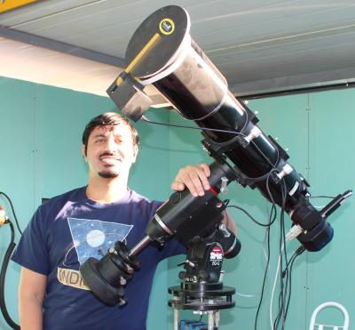
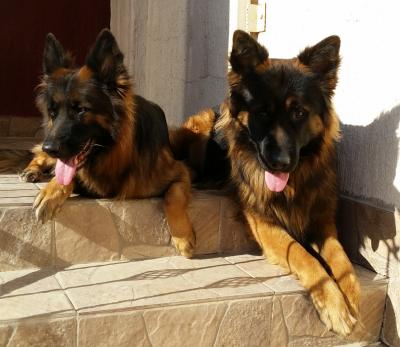

Jasem is the lead developer INDI Library & Ekos. He maintains INDI Library since 2004 and developed the original LX200 drivers and all subsequent LX200 based drivers. The following is a list of areas he worked on:

-   Core: Created INDI Base, Client, and Common Libraries. Several improvements to INDI server.
-   INDI Server: FIFO Mode for dynamic startup/shutdown of drivers.
-   INDI Client Library: Base library for all INDI Clients to communicate with INDI servers and drivers.
-   Documentation: API, INDI Developer's Manual, Examples, FAQ, Tutorials, and INDI Site content.
-   Developed drivers for the following devices:

    -   Mounts:
        -   Meade LX200 based controllers (Autostar, Classic, GPS, Basic...etc).
        -   Celestron.
        -   Astrophysics
        -   ZEQ25
        -   IEQPro
        -   Astro-Electronics FS-2
        -   Losmandy Gemini
        -   Pulsar 2
        -   Simulator
    -   CCDs & Filter Wheels:
        -   QSI CCD
        -   QHY CCD & Filter Wheel
        -   Apogee CCD
        -   Fishcamp CCD
        -   FLI CCD, Filter Wheel, and Focuser
        -   ASI CCD
        -   Xagyl Filter Wheel
        -   TruTech Filter Wheel
        -   Filter Wheel Simulator
        -   V4L2

    

    -   Domes:
        -   Baader Dome
        -   Roll Off base
        -   Simulator
    -   Focusers:
        -   Focus Lynx
        -   MoonLite
        -   N Focus
        -   Perfect Star
        -   Robo Focus
        -   Baader Steeldrive Focuser
        -   Optec TCF-S Focuser
    -   Weather:
        -   Vantage Pro
        -   WunderGround
        -   Weather Meta driver
    -   Auxilary:
        -   Joystick
        -   Optec Flip-Flat and Flat-Man
        -   GPUSB
        -   WatchDog driver and client.
        -   GPS Simulator

Jasem is also a core developer of KStars & Ekos. Besides astronomy, Jasem enjoys gaming, biking, hiking, and spending too much time with his two dogs: Tommy, and Juli!
