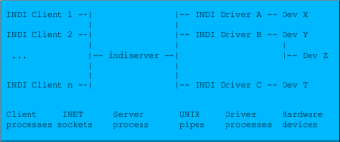
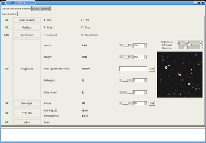
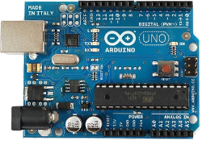
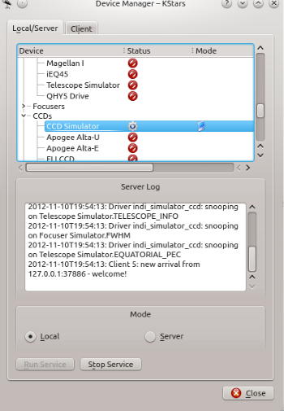

-   ## What is INDI Library?

    INDI Library is a collection of programs designed to control astronomical equipment including:

    -   Telescopes
    -   Cameras: CCDs, CMOS, and DSLRs
    -   Domes
    -   Focusers
    -   Filter Wheels
    -   Spectrographs
    -   Radio & Photon Detectors.
    -   Rotators.
    -   Adaptive Options.
    -   Many more!

    It is based on the INDI protocol which is designed to support control, automation, data acquisition, and exchange among hardware devices and software frontends. INDI stands for the Instrument-Neutral-Distributed-Interface, and was developed by _Elwood C. Downey_ of ClearSky Institute.

    Control systems are often written for a specific device or range of devices. When one or more of the device parameters change, the software needs to be modified to accommodate the change. That is, the software frontend and hardware backend are tightly coupled.

    INDI Control Protocol INDI resolves this problem by providing a framework that decouples low level hardware drivers from high level front end clients. That is, clients that use the device drivers are completely unaware of the device capabilities. In run time, clients communicate with the device drivers and build a completely dynamical GUI based on the services provided by the device.

    INDI Library primary components are:

    -   **Server**: Central hub for communication between drivers and clients.
    -   **Driver**: Software to control device and provide its properties in a standard format.
    -   **Client**: Front-end software that enables the user to interact with the devices.

    

    In essence, INDI provides the capacity to describe any device and its parameters to any INDI-compliant client. Once you have a client, you can develop as many devices as you can _without any changes on the client side_. But this is not all! Since INDI's protocol is based on XML, it can be easily parsed and nested in other frameworks. For example, you can incorporate INDI in RTML to place observational constraints on your devices. Furthermore, remote control of devices is seamless with INDI's server/client architecture. Distributed devices can be controlled from one centralized environment. Finally, INDI drivers are scriptable using INDI scripting tools. You can use these command line tools in your favourite language to have complete control of the device. These tools enable developers to provide scheduling and automation frameworks for their devices.

-   ## What are INDI drivers?

    INDI driver is what communicates directly to your device. A driver may connect to one or more physical devices. It is responsible for controlling the device parameters and for defining them to clients. Drivers send a list of supported device properties to clients where they are parsed and presented to the end users.

    For more information on INDI drivers, please refer to INDI Developers Manual.

-   ## What is INDI Server?

    INDI server is the hub that sits between your devices and your clients. It reroutes traffic for control and data acorss distributed networks. Each device or client in the network is a node and may communicate with other nodes whenever desired. The server supports broadcasting, chaining, and marshalling of data. Moreover, the server support dynamic startup and shutdown of devices upon request.

    

-   ## What are INDI Clients?

    Clients are the software frontends that communicate with the hardware drivers. They usually communicate with INDI hardware drivers via INDI server, though they can communicate with the drivers directly. There are many types of clients, most notably:

    

    -   Generic GUI clients like KStars, jINDI, or Xephem. Such clients generate a dynamic GUI to offer users a control panel to control the device.
    -   Clients for tablets & smart phones (e.g. Andriod Client).
    -   Logger clients to record messages, alarms, and data exchanged between devices and clients.
    -   Watch dog clients to insure safe and proper operation of devices.
    -   Automated scripts to carry on complex and coordinates operations on devices.
-   ## Which devices can INDI control?

    Thanks to the generic nature of INDI, INDI can virtually control any device. While our focus is astronomical instruments, there is nothing that prevents you from writing an INDI driver for your _toaster!_ Currently, INDI Library supports a growing number of telescopes, CCD, focusers, filter wheels and video capture devices. For a complete list, please visit INDI devices page. If your device doesn't exist in the devices list page, there is a couple of things you can do:

    -   Ask your device manafacturer to provide an INDI driver.
    -   Write your own INDI driver for the device. Refer to INDI Developers Manual on driver development HOWTO, the manual also includes many tutorials and examples.
    -   If you lack programming knowledge and have the technical specification for your device, you may send the information to INDI Development mailing list. One of the developers might be interested in developing a driver for your device.
-   ## How can I use INDI?

    INDI Library is shipped with many Linux distributions today by default.  Check if your distribution includes one of INDI compatible clients. Ideally, GUI clients should take care of establishing INDI server and providing users with a list of supported drivers.

    INDI is also available for Mac OS via Homebrew, MacPorts, the INDI Web Manager App, the INDI Starter App, as well as being bundled with KStars for Mac OS.

    Support for Windows port of INDI Library is under progress. Nevertheless, you may opt to use wINDI which is a complete implementation of INDI under .NET. You may use the INDI version shipped with your client, or at your option, you may download the latest stable INDI release from the download section.

    

    All INDI compatible clients can also connect to local and remote INDI servers. So you should first start INDI server, then configure your client to connect to it. INDI server must be running on the same physical machine connected to the device. For example, to start INDI server to run the LX200 GPS telescope on localhost and listening on default port 7624, type:

    ```shell
    $ indiserver indi_lx200gps
    ```
