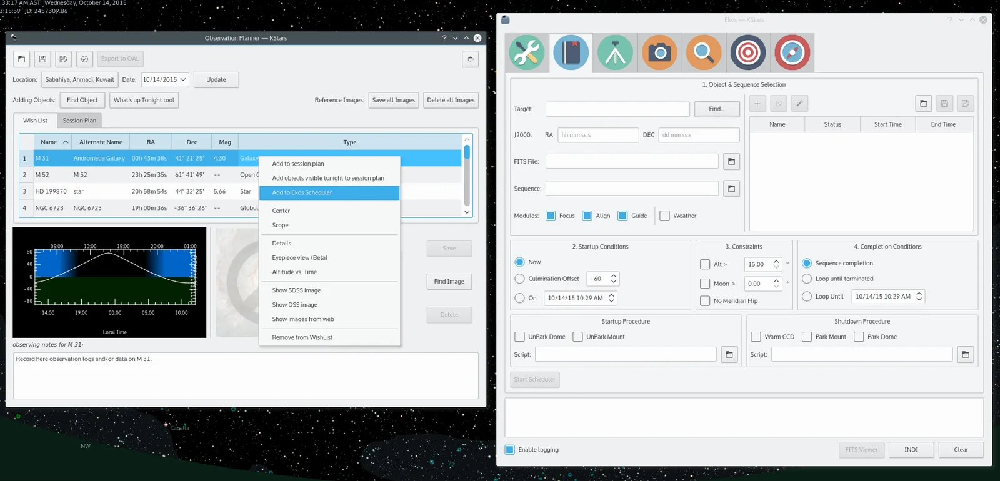
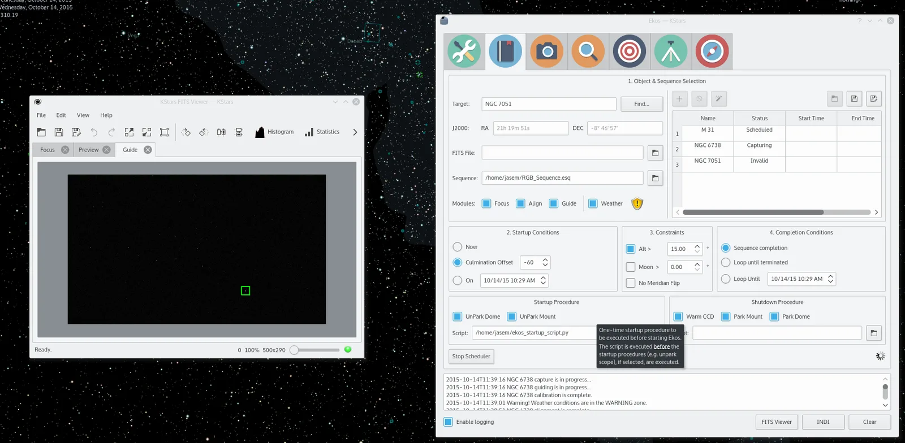
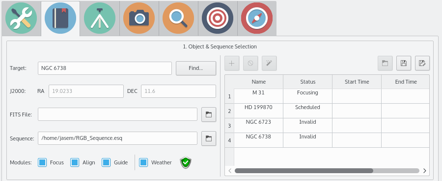

A Robotic observatory is an observatory composed of several subsystems that are orchestrated together to achieve a set of scientific objectives without human intervention.



With Ekos, the user can utilize the powerful sequence queue to image batches of images for a particular target. In simple setups, the user is expected to focus the CCD, align the mount, frame the target, and start guiding before initiating the capture process. For more complex observatory environments, there are usually predefined custom procedures to be executed to prepare the observatory for imaging, and another set of procedures on shutdown. The user may plan to image one or more targets during the night, and expects data to be ready by morning. In KStars, tools such as the [Observation Planner](https://docs.kde.org/stable5/en/kdeedu/kstars/tool-obsplanner.html) and What's up Tonight help the user in selecting candidates for imaging. After selecting the desired candidates, the user can add them to the Ekos Scheduler list for evaluation. The user may also add the targets directly in Ekos scheduler or select a FITS file of a previous image.

Ekos Scheduler provides a simple interface to aid the user in setting the conditions and constraints required for an observation job. Each observation job is composed of the following:

-   **Target name and coordinates**: The target can either be J2000 RA/DEC coordinates or a FITS file.
-   **Optional FITS file**: If a FITS file is specified, the astrometry solver shall solve the file and use the central RA/DEC as the target coordinates.
-   **Sequence File**: The sequence file is constructed in the Ekos [CCD module](/about/ekos/capture-module.html). It contains the number of images to capture, filters, temperature settings, prefixes, download directory..etc.
-   **Module selection**: The user selects which Ekos modules should be utilized in the observation job execution workflow.
-   **Startup Conditions**: Conditions that must be met **before** the observation job is started. Currently, the user may select to start as soon as possible _Now_, or when the target is near or past culmination, or at a specific time.
-   **Constraints**: Constraints are conditions that must be met **at all times** during the observation job execution process. These include minimum target altitude, minimum moon separation, and meridian crossing.
-   **Completion Conditions**: Conditions that trigger completion of the observation job. The default selection is to simply mark the observation job as complete once the sequence process is complete. Additional conditions enable the user to repeat the sequence process indefinitely or up until a specific time.



When the scheduler starts, it evaluates all jobs in accord to the conditions and constraints specified and attempts to select the best job to execute. Selection of the job depends on a simple heuristic algorithm that scores each job given the conditions and constraints, each of which is weighted accordingly. If two targets have identical conditions and constraints, usually the higher altitude target is selected for execution. If no candidates are available at the current time, the scheduler goes into sleep mode and wakes up when the next job is ready for execution.

The description above only tackles the **Data Acquisition** stage of the observatory workflow. The overall procedure typically utilized in an observatory can be summarized in three primary stages:

1.  Startup
2.  Data Acquisition (including preprocessing and storage)
3.  Shutdown

Startup procedure is unique to each observatory but may include:

-   Turning on power to equipment
-   Running safety/sanity checks
-   Checking weather conditions
-   Turning off light
-   Fan/Light control
-   Unparkig dome
-   Unparking mount
-   ..etc



Ekos Scheduler only initiates the startup procedure once the startup time for the first observation job is close (default _lead_ time is 5 minutes before _startup_ time). Once the startup procedure is completed successfully, the scheduler picks the observation job target and starts the sequence process. Depending the on the user selection, the typical workflow proceeds as following:

-   Slew mount to target.
-   Auto-focus target. The autofocus process automatically selects the best star in the frame and runs the autofocus algorithm against it.
-   Perform plate solving, sync mount, and slew to target coordinates.
-   Perform calibration and start auto-guiding: The calibration process automatically selects the best guide star, performs calibration, and starts the autoguide process.
-   Load the sequence file in the [CCD module](/about/ekos/capture-module.html) and start the imaging process.

Once the observation job is completed successfully, the scheduler selects the next target. If the next target scheduled time is not due yet, the mount is parked until the target is ready. Furthermore, if the next scheduled target is not due for a user-configurable time limit, the scheduler performs a _preemptive_ shutdown to preserve resources and performs the startup procedure again when the target is due.

Another critical feature of any remotely operated robotic observatory is weather monitoring. For weather updates, Ekos relies on the selected INDI weather driver to continuously monitor the weather conditions. For simplicity sake, the weather conditions can be summed in three states:

1.  **Ok**: Weather conditions are clear and optimal for imaging.
2.  **Warning**: Weather conditions are not clear, seeing is subpar, or partially obstructed and not suitable for imaging. Any further imaging process is suspended until weather improves. Warning weather status does not pose any danger to the observatory equipment so the observatory is kept operational. The exact behavior to take under Warninig status can be configured.
3.  **Alert**: Weather conditions are detrimental to the observatory safety and shutdown must be initiated as soon as possible.

Due to the uniqueness of each observatory, Ekos enables the user to select startup and shutdown scripts. The scripts takes care of any necessary procedures that must take place on startup and shutdown stages. On startup, Ekos executes the startup scripts and only proceeds to the remainder of the startup procedure (unpark dome/unpark mount) if the script completes successfully. Conversely, the shutdown procedure begins with parking the mount & dome before executing the shutdown script as the final procedure.

Startup and shutdown scripts can be written any language that can be executed on the local machine. It must return 0 to report success, any other exist value is considered an error indicator. The script's standard output is also directed to Ekos logger window. The following is as sample demo startup script in Python:

```python

#!/usr/bin/env python
# -*- coding: utf-8 -*-

import os
import time
import sys

print "Turning on observatory equipment..."
sys.stdout.flush()

time.sleep(5)

print "Checking safety switches..."
sys.stdout.flush()

time.sleep(5)

print "All systems are GO"
sys.stdout.flush()

exit(0)
```

The startup and shutdown scripts must be _executable_ in order for Ekos to invoke them (e.g. use **chmod +x startup_script.py** to mark the script as executable). Ekos Scheduler enables truly simple robotic operation without the need of any human intervention in any step of the process. Without human presence, it becomes increasingly critical to gracefully recover from failures in any stage of the observation run. Using KDE notifications, the user can configure audible alarms and email notifications for the various events in the scheduler.

The Ekos scheduler is still under _active_ development. Join us at the [forums](https://forum.indilib.org) to discuss any scheduler related suggestions or issues.
