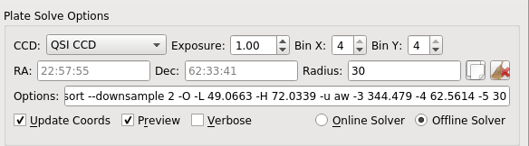

##  Introduction

Ekos Alignment Module enables highly accurate GOTOs to within sub-arcseconds accuracy and can measure and correct polar alignment errors. This is possible thanks to the astrometry.net solver. Ekos begins by capturing an image of a star field, feeding that image to [astrometry.net](http://www.astrometry.net) solver, and getting the central coordinates (RA, DEC) of the image. The solver essentially performs a pattern recognition against a catalog of millions of stars. Once the coordinates are determined, the true pointing of the telescope is known. Often, there is a discrepancy between where the telescope thinks it is looking at and where it is truly pointing. The magnitude of this discrepancy can range from a few arcminutes to a couple of degrees. Ekos can then correct the discrepancy by either syncing to the new coordinates, or by slewing the mount to the desired target originally requested.

Furthermore, Ekos can measure the misalignment in the polar axis by taking a couple of images near the meridian and east/west of the meridian. This will enable the user to adjust the mount until the misalignment is minimized.

At minimum, you need a CCD/Webcam and a telescope that supports Slew & Sync commands. Most popular commercial telescope nowadays support such commands.

For the Ekos Alignment Module to work, you have an option of either utilizing the online astrometry.net solver, or the offline solver. The online solver requires no configuration, and depending on your Internet bandwidth, it might take a while to upload and solve the image. The offline solver can be faster and requires no Internet connection. In order to use the offline solver, you must install astrometry.net in addition to the necessary index files. If you are running Ubuntu, you can install it by running the following command:
`sudo apt-get install astrometry.net`

After astrometry.net is installed, you must [download](http://data.astrometry.net) and install the necessary index files suitable for your telescope+CCD field of view (FOV). You need to install index files covering 100% to 10% of your FOV. For example, if your FOV is 60 arcminutes, you need to install index files covering skymarks from 6 arcminutes (10%) to 60 arcminutes (100%). There are many online tools to calculate FOVs, such as [Starizona Field of View Calculator.](http://starizona.com/acb/ccd/calc_pixel.aspx)

| Index Filename | FOV (arcminutes) | Debian Package |
| --- | --- | --- |
| index-4219.fits | 1400 - 2000 | [astrometry-data-4208-4219](http://data.astrometry.net/debian/astrometry-data-4208-4219_0.45_all.deb) |
| index-4218.fits | 1000 - 1400 |
| index-4217.fits | 680 - 1000 |
| index-4216.fits | 480 - 680 |
| index-4215.fits | 340 - 480 |
| index-4214.fits | 240 - 340 |
| index-4213.fits | 170 - 240 |
| index-4212.fits | 120 - 170 |
| index-4211.fits | 85 - 120 |
| index-4210.fits | 60 - 85 |
| index-4209.fits | 42 - 60 |
| index-4208.fits | 30 - 42 |
| index-4207-\*.fits | 22 - 30 | [astrometry-data-4207](http://data.astrometry.net/debian/astrometry-data-4207_0.45_all.deb) |
| index-4206-\*.fits | 16 - 22 | [astrometry-data-4206](http://data.astrometry.net/debian/astrometry-data-4206_0.45_all.deb) |
| index-4205-\*.fits | 11 - 16 | [astrometry-data-4205](http://data.astrometry.net/debian/astrometry-data-4205_0.45_all.deb) |
| index-4204-\*.fits | 8 - 11 | [astrometry-data-4204](http://data.astrometry.net/debian/astrometry-data-4204_0.45_all.deb) |
| index-4203-\*.fits | 5.6 - 8.0 | [astrometry-data-4203](http://data.astrometry.net/debian/astrometry-data-4203_0.45_all.deb) |
| index-4202-\*.fits | 4.0 - 5.6 | [astrometry-data-4202](http://data.astrometry.net/debian/astrometry-data-4202_0.45_all.deb) |
| index-4201-\*.fits | 2.8 - 4.0 | [astrometry-data-4201-1](http://data.astrometry.net/debian/astrometry-data-4201-1_0.45_all.deb)
[astrometry-data-4201-2](http://data.astrometry.net/debian/astrometry-data-4201-2_0.45_all.deb)
[astrometry-data-4201-3](http://data.astrometry.net/debian/astrometry-data-4201-3_0.45_all.deb)
[astrometry-data-4201-4](http://data.astrometry.net/debian/astrometry-data-4201-4_0.45_all.deb) |
| index-4200-\*.fits | 2.0 - 2.8 | [astrometry-data-4200-1](http://data.astrometry.net/debian/astrometry-data-4200-1_0.45_all.deb)
[astrometry-data-4200-2](http://data.astrometry.net/debian/astrometry-data-4200-2_0.45_all.deb)
[astrometry-data-4200-3](http://data.astrometry.net/debian/astrometry-data-4200-3_0.45_all.deb)
[astrometry-data-4200-4](http://data.astrometry.net/debian/astrometry-data-4200-4_0.45_all.deb) |

The Debian packages are suitable for any Debian-based distribution (Ubuntu, Mint...etc). If you downloaded the Debian Packages above for your FOV range, you can install them from your favorite package manager, or via the following command:

`sudo dpkg -i astrometry-data-*.deb`

On the other hand, if you downloaded the FITS index files directly, copy them to `/usr/share/astrometry` directory.

 It is recommended to use a download manager as such [DownThemAll!](https://addons.mozilla.org/en-US/firefox/addon/downthemall/) for Firefox to download the Debian packages as browsers' built-in download manager may have problems with download large packages.

##  Alignment Options

The alignment options are passed to the astrometry.net solver and Ekos each time an image is captured:

-   **_CCD_**: Select CCD to capture from
-   **_Exposure_**: Exposure duration in seconds
-   **_Bin X_**: Set horizontal binning of the CCD
-   **_Bin Y_**: Set vertical binning of the CCD
-   **_RA_**: RA coordinates of the search pattern
-   **_DEC_**: DEC coordinates of the search pattern
-   **_Radius_**: Radius in degrees of the search pattern
-   **_Options_**: Options that are passed to the astrometry.net solver. For more details on the options, please refer to astrometry.net
-   **_Update Coordinates After Slew_**: If checked, it will automatically update the RA & DEC values for the solver search pattern whenever the telescope completes a successful slew/track.
-   **_Preview_**: If checked, display captured FITS image in FITSViewer tool.
-   **_Verbose_**: If checked, display detailed information in the logging window.

By default, the solver will search all over the sky to determine the coordinates of the captured image. This can _take a lot of time_; therefore, in order to speed up the solver, you can restrict it to only search within a specified area in the sky designated by the RA, DEC, and Radius options above. The Solver's RA & DEC coordinates can be updated automatically whenever the mount successfully completely slewing, if the **_Update Coordinates After Slew_** is checked. Alternatively, you can use the copy icon  to copy the telescope coordinates to the solver options. While the telescope coordinates will certainly differ from the actual target coordinates (unless you are perfectly aligned already!), they are close enough to be utilized properly by the solver.

##  Alignment Modes

Ekos provides two alignment modes:

###  GOTO

Using the GOTO mode, Ekos captures and solves an image, and if the solver is successful, it can perform the following actions:

-   _**Sync**_: Syncs the telescope coordinates to the solution coordinates.
-   _**Slew to Target**_: Syncs the telescope coordinates to the solution coordinates and then slew to the target.
-   _**Nothing**_: Just solve the image and display the solution coordinates.

###  Polar Alignment

Using the Polar Alignment mode, Ekos can measure and correct for polar alignment errors. To measure Azimuth error, point your mount to a star close to the meridian. If you live in the northerm hemisphere, you will point the mount toward the southern meridian. Click on _**Measure Az Error**_ to begin the process. Ekos will try to measure the drift between two images and calculates the error accordingly. You can ask Ekos to correct Azimuth error by clicking on _**Correct Az Error**_ button. Ekos will slew to a new location and asks you to adjust the mount's azimuth knobs until the star is in the center of the Field of View. You can use the Focus Module's Framing feature to take a look at the image as you make your adjustments.

Similarly, to measure Altitude error, click on the _**Measure Alt Error**_ button. You need to point your mount either east or west, and set the _**Altitude Direction**_ combo box accordingly. Ekos will take two images and calculates the error. You can ask Ekos to correct Altitude error by clicking on the _**Correct Alt Error**_ button. As with Azimuth correction, Ekos will slew to a new location and asks you to adjust the mount's altitude knobs until the star is in the center of the FOV.

After making a correction, it is recommended to measure the Azimuth and Altitude errors again and gauge the difference. You may need to perform the correction more than once to obtain optimal results.

##  GOTO Workflow

Using Ekos Alignment Module, aligning your mount using the controller's 1, 2, or 3 star alignment is not strictly necessary, though for some mounts it is recommended to perform a rough 1 or 2 star alignment before using Ekos alignment module. If you are using EQMod, you can start using Ekos alignment module right away. A typical workflow for GOTO alignment involves the following steps:

1.  Set your mount to its home position (usually the NCP for equatorial mounts)
2.  Select **_Slew to Target_** in the GOTO options.
3.  Check **_Update Coordinates After Slew_** in the Plate Solver options.
4.  Slew to a nearby bright star
5.  After slew is complete, click **_Capture & Solve_**

If the solver is successful, Ekos will sync and then slew to the star. You can verify this by capturing an image in the CCD Module. You can repeat this process as needed. For drivers such as EQMod, the more sync points you add to the model, the better the alignment model becomes.

##  Polar Alignment Workflow

Before starting the Polar Alignment tool, you must complete the GOTO Workflow above for at least one point in the sky. Once your mount is aligned, proceed with the following (assuming you live in the northern hemisphere):

1.  Slew to a **bright** star (4th magnitude or below) near the southern meridian (Azimuth 180). Make sure _Slew to Target_ is selected. Capture and solve. The star should be exactly centered in your CCD field of view.
2.  Switch mode to _Polar Alignment_. Click _Measure Az Error_. It will ask you to slew to a star at the southern meridian which we already done, click continue. Ekos will now perform the error calculation.
3.  If all goes well, the error is displayed in the output boxes. To correct for the error, click _Correct Az Error_. Ekos will now slew to a different point in the sky, and you will be required to **ONLY** adjust the mount's azimuth knobs to center the star in the field of view. The most convenient way of monitoring the star field is by going to the _Focus_ module and clicking _Start Framing_. If the azimuth error is great, the star might not be visible in the CCD field of view, and therefore you have to make _blind_ adjustments (or simply look through the finderscope) until the star enters the CCD FOV.
4.  Begin your azimuth adjustments until the bright star you slewed to initially is as close to center as you can get it
5.  **Stop Framing** in the Focus module.
6.  Repeat the _Measure Az Error_ to ensure we indeed corrected the error. You might have to run it more than once to ensure the results are valid.
7.  Switch mode to _GOTO_.
8.  Now slew to a **bright** star either on the eastern or western horizon, preferably above 20 degrees altitude. It has to be as close as possible to the eastern (90 azimuth) or western (270) cardinal points.
9.  After slew is complete, capture and solve. The star should be dead center in the CCD FOV now.
10.  Switch mode to _Polar Alignment_
11.  Click _Measure Alt Error_. It will ask you to slew to a star at either the eastern (Azimuth 90) or western (Azimuth 270) which we already done, click continue. Ekos will now perform the error calculation.
12.  To correct for the error, click _Correct Alt Error_. Ekos will now slew to a different point in the sky, and you will be required to **ONLY** adjust the mount's altitude knobs to center the star in the field of view. Start framing as done before in the focus module to help you with the centering.
13.  After centering is complete, stop framing.
14.  Repeat the _Measure Alt Error_ to ensure we indeed corrected the error. You might have to run it more than once to ensure the results are valid.
15.  Polar alignment is now complete!

The mount may slew to a dangerous position and you might risk hitting the tripod and/or other equipment. Carefully monitor the mount's motion. Use at your own risk.
