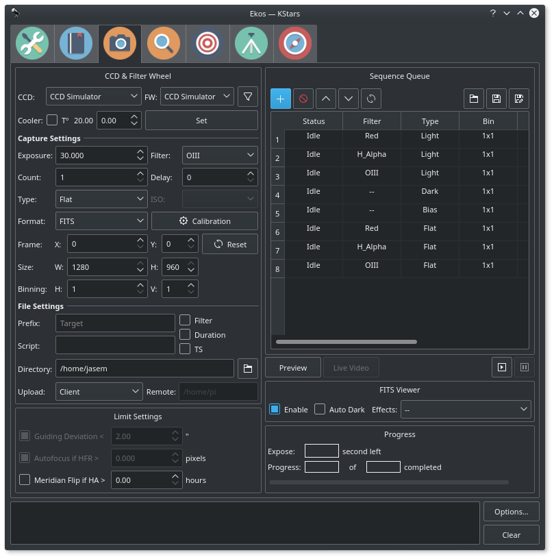
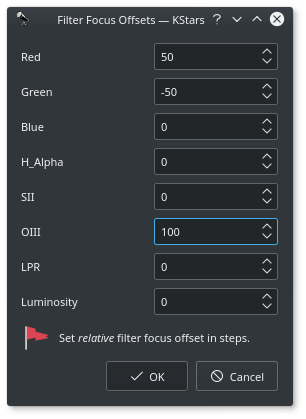
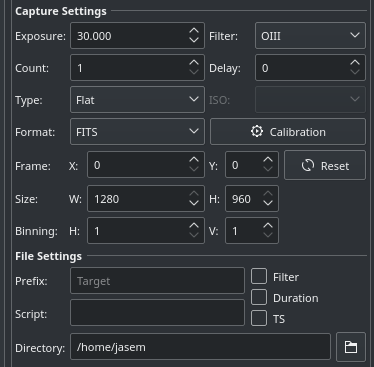
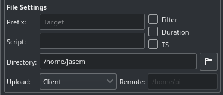
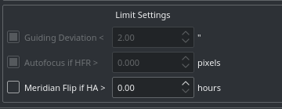
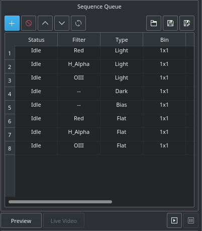
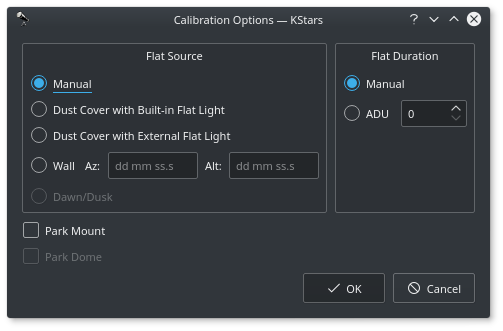

The CCD Module is your primary image and video acquisition module in Ekos. It enables you to capture single (Preview), multiple images (Sequence Queue), or record [SER](https://sites.google.com/site/astropipp/ser-player) videos along with selection of filter wheel, if available.

## CCD & Filter Wheel Group

Select the desired CCD/DSLR and Filter Wheel (if available) for capture. Set CCD temperature and filter offset settings.

-   **CCD**: Select the active CCD camera. If your camera has a guide head, you can select it from here as well.
-   **FW**: Select the active Filter Wheel device. If your camera has a built-in filter wheel, the device would be the same as the camera.
-   **Filter Offsets**: Click the filter icon  next to the filter wheel selection box to open the filter offset dialog. If you are using filters that are not parafocal with each other and require a specific amount of focus offsets in order to get them into proper then set all the **relative** focus offsets in the dialog.

    Ekos will command a focus offset change if there is a difference between the _current_ and _target_ filter offsets. For example, given the values in the example image to the right, if the curernt filter is set to _Red_ and next filter is _Green_, then Ekos shall command the focuser to _Focus In_ by 100 ticks (50 - -50 = 100). Relative positive focus offsets denote _Focus Out_ while negative values denote _Focus In_.

-   **Cooler**: Set the desired temperature, if you camera is equipped with a cooler. Check the option to force temperature setting before any capture. Capture process is only started after measured temperature is within requested temperature tolerance. The default tolerance is 0.1 degrees Celsius, but can be adjusted in Capture options under Ekos configuration.

## Capture Settings

Set all capture parameters as detailed below. Once set, you can capture a preview by click on **Preview** or add a job to the sequence queue.

-   **Exposure**: Specify exposure duration in seconds.
-   **Filter**: Specify desired filter.
-   **Count**: Number of images to capture
-   **Delay**: Delay in seconds between image captures.
-   **Type**: Specify the type of desired CCD frame. Options are Light, Dark, Bias, and Flat frames.
-   **ISO**: For DSLR cameras, specify the ISO value.
-   **Format**: Specify capture save format. For all CCDs, only **FITS** option is available. For DSLR cameras, you can an additional option to save in **Native** format (e.g. RAW or JPEG).
-   **Calibration**: For Dark &s; Flat frames, you can set additional options explained in the [Calibration Frames section below](#h7-calibration-frames).
-   **Frame**: Specify the left (X), top (Y), width (W), and height (H) of the desired CCD frame. If you changed the frame dimensions, you can reset it to default values by clicking on the reset button.
-   **Binning**: Specify horizontal (X) and vertical (Y) binning.

## File Settings

Settings for specifying where captured images are saved to, and how to generate unique file names in addition to upload mode settings.

-   **Prefix**: Specify prefix to append to the generated filename. You may also append the frame type, filter, expose duration, and ISO 8601 timestamp. For example, if you specify Prefix as **M45** and checked the Type and Filter checkboxes, and assuming your filter was set to **Red** and your frame type is **Light**, the generated file names will be as following:

    -   M45_Light_Red_001.fits
    -   M45_Light_Red_002.fits

    If **_TS_** was checked, a timestamp will be appended to the filename, e.g.
    -   M45_Light_Red_001_2016-11-09T23-47-46.fits
    -   M45_Light_Red_002_2016-11-09T23-48-34.fits
-   **Script**: Specify an _optional_ script to be executed after each capture is complete. The full path of the script must be specified and it must executable. To denote success, the script must return zero as this would allow the sequence to continue. If a non-zero value is returned by the script, the sequence is aborted.
-   **Directory**: Local directory to save the sequence images to.
-   **Upload**: Select how captured images are uploaded:

    1.  **Client**: Captured images are only uploaded to Ekos and saved to the local directory specified above.
    2.  **Local**: Captured images are only saved locally on the remote computer.
    3.  **Both**: Captured images are saved on remote device **and** uploaded to Ekos.

    When selecting _Local_ or _Both_, you must specify the remote directory where the remote images are saved to. By default, all captured images are uploaded to Ekos.

-   **Remote**: When selecting either _Local_ or _Both_ modes above, you must specify the remote directory where remote images are saved to.

## Limit Settings

Limit settings are applicable to all the images in the sequence queue. When a limit is exceeded, Ekos shall command the appropiate action to remedy the situation as explained below.

-   **Guiding Deviation**: If checked, it enforces a limit of maximum allowable guiding deviation for the exposure, if autoguiding is used. If the guiding deviation exceeds this limit in arcseconds, it aborts the exposure sequence. It will automatically resume the exposure sequence again once the guiding deviation goes below this limit.
-   **Autofocus if HFR exceeds a value**: If autofocus is enabled in the focus module and at least one autofocus operation was completed successfully, you can set the maximum acceptable HFR value. If this option is enabled then between consecutive exposures, the HFR value is recalculated, and if found to exceed the maximum acceptable HFR value, then an autofocus operation is automatically triggered. If the autofocus operation is completed successfully, the sequence queue resumes, otherwise the job is aborted.
-   **Meridian Flip**: If supported by the mount, set the hour angle limit (in hours) before a [meridian flip](http://astronomy.mdodd.com/gem_movement.html) is commanded. For example, if you set the meridian flip duration to 0.1 hours. Ekos shall wait until the mount passes the meridian by 0.1 hours (6 minutes), then it commands the mount to perform a meridian flip. After the meridian flip is complete, Ekos re-aligns using astrometry.net (if alignment was used) and resumes guiding (if it was started before) and then resumes the capture process automatically.

## Sequence Queue

Sequence Queue is the primary hub of the Ekos Capture Module. This is where you can plan and execute jobs using the sequence queue built-in powerful editor. To add a job, simply select all the parameters from the capture and file settings as indicated above. Once you selected your desired parameters, click on the add button  in the sequence queue to add it to the queue.

You can add as many jobs as desired. While it is not strictly necessary, it is prefereable to add the dark and flat jobs after the light frames. Once you are done adding jobs, simply click **Start Sequence**  to begin executing the jobs. A job state changes from **_Idle_** to **_In Progress_** and finally to **_Complete_** once it is done. The Sequence Queue automatically starts the next job. If a job is aborted, it may be resumed again. To pause a sequence, click the pause button  and the sequence will be stopped after the current capture is complete. To reset the status of all the jobs, simply click the reset button . Please beware that all image progress counts are reset as well. To preview an image in KStars FITS Viewer, click the **_Preview_** button.

Sequence queues can be saved as an XML file with extension .esq (Ekos Sequence Queue). To load a sequence queue, click the open document button . Please note that it will replace any current sequence queues in Ekos.

 **Job Progress**: Ekos is designed to execute and resume the sequence over multiple nights if required. Therefore, if **Remember Job Progress** option is enabled in Ekos Options, Ekos shall scan the file system to count how many images are already completed and will resume the sequence from where it was left off. If this default behavior is not desired, simply turn off **Remember Job Progress** under options.

To edit a job, double click it. You will notice the add button  now changed to check mark button . Make your changes on the left hand side of the CCD module and once done, click on the check mark button. To cancel a job edit, click any where empty within the sequence queue table.

If your camera supports live video feed, then you can click the **Live Vide** button to start streaming. The video stream window enables recording and subframing of the video stream. For more information, check the video below:

<iframe src="https://www.youtube-nocookie.com/embed/qRsAqTL4ZZI" title="Video" loading="lazy" allowfullscreen=""></iframe>

## FITS Viewer

Captured images are displayed in KStars FITS Viewer tool, and also in the summary screen. Set options related to how the images are displayed in the viewer.

-   **Auto Dark**: You can capture an image and auto dark subtract it by checking this option. Note that this option is only applicable when using **_Preview_**, you cannot use it in batch mode sequence queue.
-   **Effects**: Image enhancement filter to be applied to the image after capture.

## Calibration Frames

For Flat Field frames, you can set calibration options in order to automate the process. The calibration options are designed to facilitate automatic unattended flat field frame capture. It can also be used for dark and bias frames if desired. If your camera is equipped with a mechanical shutter, then it is not necessary to set calibration settings unless you want to close the dust cover to ensure no light at all passes through the optical tube. For flat fields, you must specify the flat field light source, and then specify the duration of the flat field frame. The duration can be either manual, or based on ADU calculations.

1.  Flat Field Source
    -   **Manual**: The flat light source is manual.
    -   **Dust Cover with Built-In Flat Light**: If using a dust cover with built-in light source (e.g. FlipFlat). For dark and bias frames, close the dust cap before proceeding. For flat frames, close the dust cap and turn on the light source.
    -   **Dust Cover with External Flat Light**: If using a dust cover with external flat light source. For dark and bias frames, close the dust cap before proceeding. For flat frames, open the dust cap and turn on the light source. The external flat light source location is presumed to be the parking location.
    -   **Wall**: Light source is a panel on the observatory wall. Specify the Azimuth and Altitude coordinates of the panel and the mount shall slew there before capturing the flat field frames. If the light panel is controllable from INDI, Ekos shall turn it on/off as required.
    -   **Dawn/Dusk**: Currently unsupported.
2.  Flat Field Duration
    -   **Manual**: Duration is as specified in the Sequence Queue.
    -   **ADU**: Duration is variable until specified ADU is met.

Before the calibration capture process is started, you can request Ekos to park the mount and/or dome. Depending on your flat source selection above, Ekos will use the appropiate flat light source before starting flat frames capture. If ADU is specified, Ekos begins by capturing a couple of preview images to establish the curve required to achieve the desired ADU count. Once an appropiate value is calculed, another capture is taken and ADU is recounted until a satisfactory value is achived.
