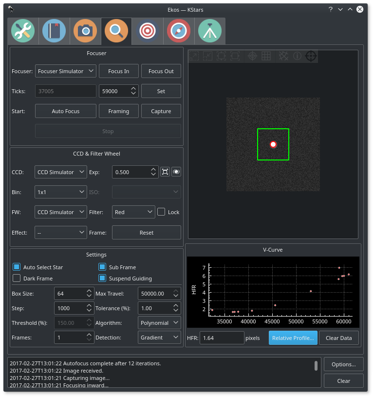
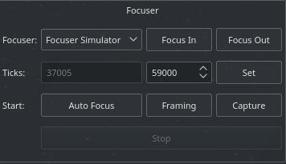
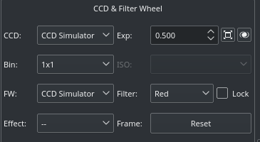
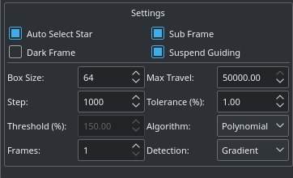
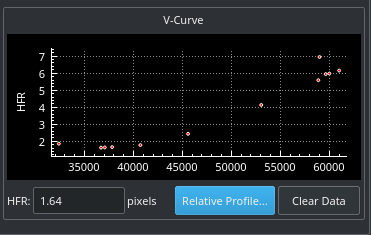
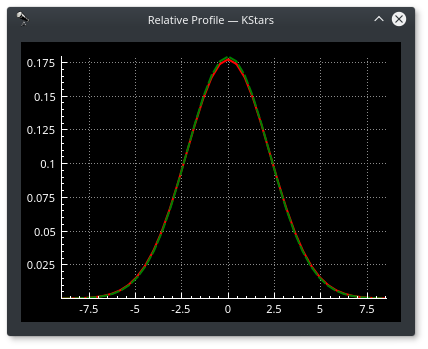

## Theory Of Operation

In order to focus an image, Ekos needs to establish a numerical method for gauging how _good_ your focus is. It's easy when you look at an image and can see it as _unfocused_, as the human is very good at detecting that, but _how_ can Ekos possibly know that?

There are multiple methods. One is to calculate the Full Width at Half Maximum (FHWM) of a star profile within an image, and then adjust the focus until an optimal (narrower) FWHM is reached. The problem with FWHM is that it assumes the initial focus position to be close to the critical focus. Additionally, FWHM does not perform very well under low intensity fluxes. An Alternative method is Half-Flux-Radius (HFR), which is a measure of the width in pixels counting from the center of the stars until the accumulated intensity is half of the total flux of the star. HFR proved to be much more stable in conditions where you might have unfavorable sky conditions, when the brightness profile of the stars is low, and when the starting position of the focus is far from the optimal focus.

After Ekos processes an image, it selects the brightest star and start measuring its HFR. It can automatically select the star, or you can select the star manually. It is usually recommended to select stars that are not too bright as they might get saturated during the focusing process. A magnitude 3 or 4 star is often sufficient.

Ekos then begins the focusing process by commanding the focuser to focus inwards or outwards, and re-measures the HFR. This establishes a V-shaped curve in which the sweet spot of optimal focus is at the center of the V curve, and the slope of which depends on the properties of the telescope and camera in use. In Ekos, a full V-curve is never constructed as the focusing process works iteratively, so under most circumstances, a half V-curve shape as illustrated in the Focus Module image is measured.

Because the HFR varies linearly with focus distance, it is possible to calculate the optimal focus point. In practice, Ekos operates iteratively by moving in discreet steps, decided initially by the user-configurable step size and later by the slope of the V-curve, to get closer to the optimal focus position where it then changes gears and performs smaller, finer moves to reach the optimal focus. In the default **Iterative** algorithm, the focus process stops when the measured HFR is within the configurable tolerance of the minimum recorded HFR in the process. In other words, whenever the process starts searching for a solution within a narrow limited range, it checks if the current HFR is within % difference compared to the minimum HFR recorded, and if this condition is met then the autofocus process is considered successful. The default value is set to 1% and is sufficient for most situations. The _**Step**_ options specify the number of _initial_ ticks the focuser has to move. If the image is severely out of focus, we set the step size high (i.e. > 250). On the other hand, if the focus is close to optimal focus, we set the step size to a more reasonable range (< 50). It takes trial and error to find the best starting tick, but Ekos only uses that for the first focus motion, as all subsequent motions depend on the V-Curve slope calculations.

When using the **Polynomial** algorithm, the process starts in the **Iterative** mode, but once we cross to the other side of the V-curve (i.e. once HFR values starts increasing again after decreasing for a while), the Ekos performs polynomial fitting to find a solution that predicts the minimum possible HFR position. If a valid solution is found, the autofocus process is considered successful.

While Ekos Focus Module support relative focusers, it is **highly recommended** to use absolute focusers.

## Focuser Group

Any INDI-compatible focuser is supported. It is recommended to use **absolute** focusers since their absolute position is known on power up. In INDI, the focuser _zero_ position is when the drawtube is **fully retracted**. When focusing _outwards_, the focuser position increases, while it decreases when focusing _inwards_. The following focuser types are supported:

-   **Absolute**: Absolute Position Focusers such as RoboFocus, MoonLite..etc
-   **Relative**: Relative Position Focusers.
-   **Simple Focusers**: DC/PWM focusers with no position feedback.

For absolute focusers, you can set the ticks count. To view a continuous feed of the camera, click the **Framing** button. An image shall be captured repeatedly according to the CCD settings in the CCD and Filter Wheel group. You can focus in and out by pressing the respective buttons, and each shall move by the step size indicated in the focus settings. For absolute and relative focusers, the step size is in units of _ticks_ and for simple DC focusers, the step size is in _milliseconds_

To begin the autofocus process, simply click the **Autofocus** button.

## CCD & Filter Wheel Group

You must specify the CCD and Filter Wheel (if any) to be used during the focusing process. You can **lock** a specific filter within the filter wheel to be utilized whenever the autofocus process is invoked. Usually, the user should select the Clear/Luminescence filter for this purpose so that Ekos always uses the same filter to perform the autofocus process. This locked filter is also used in the [Alignment Module](/about/ekos/alignment-module.html) whenever it performs any astrometry capture.

You may also select an _Effect_ filter to enhance the image for preview purposes. It is highly advisable to turn off any effects during the focusing process as it may interfere with HFR calculations. For DSLRs cameras, you can change the ISO settings. You may reset the focusing subframe to full frame capture if you click the **Reset** button.

## Settings

You may need to adjust focus settings in order to achieve a successful and reliable autofocus process. The settings are retained between sessions.

-   **Auto Star Select**: Automatically select the best focus star from the image.
-   **Subframe**: Subframe around the focus star during the autofocus procedure. Enabling subframing can significantly speed up the focus process.
-   **Dark Frame**: Check this option to capture a dark frame if necessary and perform dark-frame subtraction. This option can be useful in noisy images.
-   **Suspend Guiding**: Suspend Guiding while autofocus in progress. If the focus process can disrupt the guide star (e.g. when using Integrated Guide Port IGP whereas the guider is physically attached to the primary CCD), then it is recommended to enable this option. When using Off-Axis guider, then this option is not necessary.
-   **Box size**: Sets the box size used to enclose the focus star. Increase if you have very large stars.
-   **Max Travel**: Maximum travel in ticks before the autofocus process aborts.
-   **Step**: _Initial_ step size in ticks to cause a noticeable change in HFR value. For timer based focuser, it is the initial time in milliseconds to move the focuser inward or outward.
-   **Tolerance**: The tolerance percentage values decides when the autofocus process stops in the _Iterative_ algorithm. During the autofocus process, HFR values are recorded, and once the focuser is close to optimal position, it starts measuring HFRs against the minimum recorded HFR in the sessions and stops whenever a measured HFR value is within % difference of the minimum recorded HFR. Decrease value to narrow optimal focus point solution radius. Increase to expand solution radius.

    Caution: Setting the value too low might result in repetitive loop and would most likely result in a failed autofocus process.

-   **Threshold**: Threshold percentage value is used for star detection using the _Threshold _detection algorithm. Increase to restrict the centroid to bright cores. Decrease to enclose fuzzy stars.__
-   **Algorithm**: Select the autofocus process algorithm:
    -   **Iterative**: Moves focuser by discreet steps initially decided by the step size. Once a curve slope is calculated, further step sizes are calculated to reach optimal solution. The algorithm stops when the measured HFR is within percentage tolerance of the minimum HFR recorded in the procedure.
    -   **Polynomial**: Starts with iterative method. Upon crossing to the other side of the V-Curve, polynomial fitting coefficients along with possible minimum solution are calculated. This algorithm can be faster than purely iterative approach given a good data set.
-   **Frames**: Number of average frames to capture. During each capture, an HFR is recorded. If the instantaneous HFR value is unreliable, you can average a number of frames to increase the signal to noise ratio.
-   **Detection**: Select star detection algorithm. Each algorithm have its strengths and weaknesses. It is recommended to keep the default value unless it fails to properly detect stars.

## V-Curve

The V-shaped curve displays absolute position versus Half-Flux-Radius (HFR) values. The center of the V-curve is the optimal focus position. Once Ekos crosses from one side of the V-curve to the other, it backtracks and tries to find the optimal focus position. The final focus position is decided by which algorithm is selected.

When framing, the horizontal axis denotes the frame number. This is to aid you in the framing process as you can see how HFR changes between frames.

## Relative Profile

The relative profile is a graph that displays the relative HFR values plotted against each other. Lower HFR values correspond to narrower shapes and vice-versa. The solid red curves is the profile of the current HFR value, while the dotted green curve is for the previous HFR value. Finally, the magenta curve denotes the first measured HFR and is displayed when the autofocus process concludes. This enables you to judge how well the autofocus process improved the relative focus quality.
