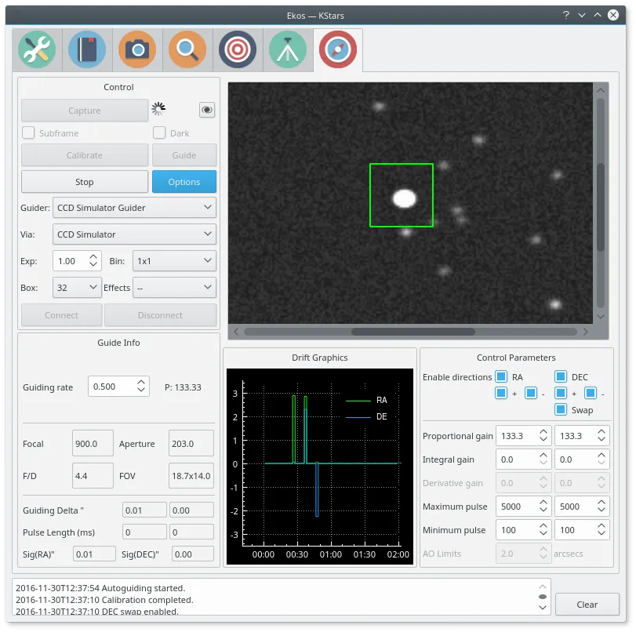
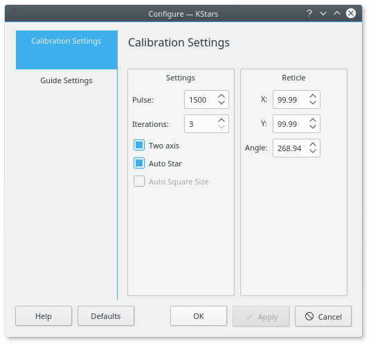
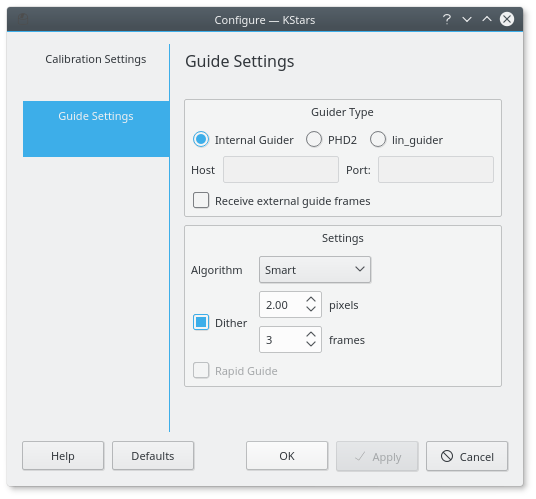
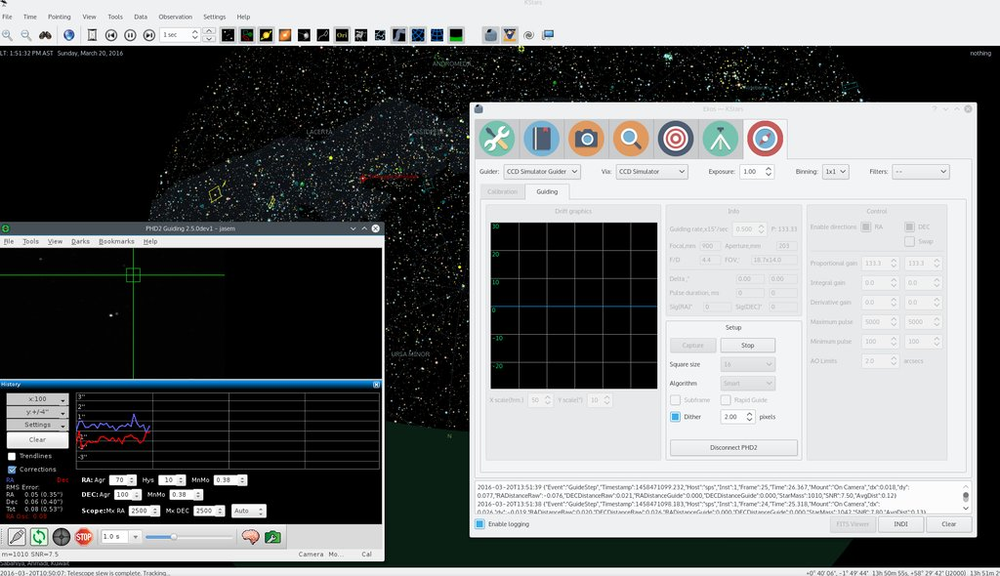

## Introduction

Ekos Guide Module enables autoguiding capability using either the powerful built-in guider, or at your option, external guiding via [PHD2](http://openphdguiding.org/) or [ln_guider](https://sourceforge.net/projects/linguider/). Using the internal guiding, guider CCD frames are captured and sent to Ekos for analysis. Depending on the deviations of the guide star from its lock position, guiding pulses corrections are sent to your mount **Via** any device that supports ST4 ports. Alternatively, you may send the corrections to your mount _directly_, if supported by the mount driver. Most of the GUI options in the Guide Module are well documented so just hover your mouse over an item and a tooltip will popup with helpful information.

To perform guiding, you need to set a Guider CCD in Ekos Setup. The telescope aperture and focal length must be set in the telescope driver. If the Guider CCD is attached to a separate Guide Scope, you must also set the Guider Scope's Focal Length and Aperture. You can set these values under the Options tab of the telescope driver. Autoguiding is a two-step process: Calibration & Guiding

During the two processes, you must set the following:

-   _**Guider**_: Select the Guider CCD.
-   _**Via**_: Selects which device receives the autoguiding correction pulses from Ekos. Usually guider CCDs have an ST4 port. If you are using the guider's ST4 to autoguide your telescope, set the guider driver in the _**Via**_ combo box. The guider CCD will receive the correction pulses from Ekos and will relay them to the mount via the ST4 port. Alternatively, some telescopes support pulse commands and you can select the telescope to be receiver of the Ekos correction pulses.
-   **_Exposure_**: CCD Exposure in seconds.
-   **_Binning_**: CCD Binning.
-   **Box**: Size of box enclosing the guide star. Select a suitable size that is neither too large or too small for the selected star.
-   _**Effects**_: Specify filter to be applied to the image to enhance it.

## Dark Frames

Dark frames are immensly helpful in reducing noises in your guide frames. It is highly recommended to take dark frames before you begin and calibration or guiding procedure. To take a dark frame, check the **Dark** checkbox and then click **Capture**. For the first time this is performed, Ekos will ask you about your camera shutter. If your camera does not have a shutter, then Ekos will warn you anytime you take a dark frame to cover your camera/telescope before proceeding with the capture. On the other hand, if the camera already includes a shutter, then Ekos will directly proceeds with taking the dark frame. All dark frames are automatically saved to Ekos Dark Frame Library. By default, the Dark Library keeps reusing dark frames for 30 days after which it will capture new dark frames. This value is configurable and can be adjusted in Ekos settings in the KStars settings dialog.

It is recommended to take dark frames covering several binning and exposure values so that they may be reused transparently by Ekos whenever needed.

## Calibration

In the calibration phase, you need to capture an image, select a guide star, and click _**Calibrate**_ to begin the calibration process. If _Auto Star_ is checked, then you are only required to click capture and Ekos will automatically select the best fit guide star in the image and continues the calibration process automatically. If _Auto Calibration_ is disabled, Ekos will try to automatically highlight the best guide star in the field. You need to confirm or change the selection before you can start the calibration process. The calibration options are:

-   _**_**Pulse**_:**_ The duration of pulses in milliseconds to be sent to the mount. This value should be large enough to cause a noticable movement in the guide star. If you increase the value and you do not notice any motion of the guide star, then this suggests possible mount issues such as jamming or connection issues via the ST4 cable.
-   _**Two axis**_: Check if you want the calibration process calibration in both RA & DEC. If unchecked, the calibration is only performed in RA.
-   _**Auto Star**_: If checked, Ekos will attempt to select the best guide star in the frame and begins the calibration process automatically.
-   _**Auto Square Size**_: If checked, Ekos will attempt to determine a suitable square size for the selected auto star.

The reticle position is the guide star position selected by you (or by the auto selection) in the captured guider image. You should select a star that is not close to the edge. If the image is not clear, you may select different **Effects** to enhance it.

Ekos begins the calibration process by sending pulses to move the mount in RA and DEC. If the calibration process fails due to short drift, try increasing the pulse duration.

Calibration can fail for a variety of reasons. To improve chances of success, try the following tips:

-   **Better Polar Alignment**: This is critical to the success of any astrophotography session. Perform a quick polar alignment with a polar scope (if available) or by using Ekos [Polar Alignment procedure](/about/ekos/alignment-module.html#polaralignment) in the Align module.
-   **Set binning to 2x2**: Binning improves SNR and is often very important to the success of the calibration and guiding procedures.
-   Prefer use ST4 cable between guide-camera and mount over using mount pulse commands.
-   Select different filter (e.g. High contrast) and see if that makes a difference to bring down the noise.
-   Smaller Square Size.
-   Take dark frames to reduce noise.
-   Play with DEC Proportional Gain or disable DEC control completely and see the difference.
-   Leave algorithm to default value (Smart)

## Guiding

You can immediately start autoguiding by clicking on the _**Guide**_ button. The guiding performance is displayed in the Drift Graphics region where Green reflects deviations in RA and blue deviations in DEC. The colors of the RA/DE lines can be changed in KStars color scheme in KStars settings dialog. The vertical axis denotes the deviation in arcsecs from the guide star central position and the horizontal axis denotes time. You can hover over the line to get the exact deviation at this particular point in time. Furthermore, you can also zoom and drag/pan the graph to inspect a specific region of the graph.

Ekos can utilize multiple algorithms to determine the center of mass of the guide star. By default, the _smart_ algorithm is suited best for most situation. The _fast_ algorithm is based on HFR calculations. You can try switching guiding algorithms if Ekos cannot keep of the guide star within the guiding square properly.

The info region displays information on the telescope & FOV, in addition to the deviations from the guide star along with the correction pulses sent to the mount.

You can select the Guider type, currently the following guiders are selected:

-   Internal Guider: Use Ekos internal guider. This is the default and recommened settings.
-   PHD2: Use PHD2 as the external guider. If selected, specify the host and port of the PHD2. Leave to default values if Ekos and PHD2 are running on the same machine.
-   LinGuider: Use LinGuider as the external guider. If selected, specify the host and port of the LinGuider. Leave to default values if Ekos and LinGuider are running on the same machine.

If **Receive External Guide Frames** is checked, then Ekos will also recieve and display guide frames captured by the external guiding application. By default, no frames are transferred from the external guiding application to Ekos. Ekos utilizes several **Algorithms** to determined the center of mass of the guide star. Only change this settings if the default algorithm fails to center the box around the selected guide star.

## Dithering

Ekos supports automatic dithering of the guide star between subsequent exposures. To enable dithering, check the _**Dither**_ checkbox and specify the dithering distance in pixels. After an exposure is complete, Ekos will move the guide star in a _random_ direction for the amount of pixels specified in the dither input box. The next exposure will be automatically started once the dithering process is complete.

## Guiding Direction Control

You can fine tune the guiding performance in the Control Section. The autoguide process works like a [PID controller](https://en.wikipedia.org/wiki/PID_controller) when sending correction commands to the mount. You can alter the Proportional and Integral gains to improve the guiding performance if necessary. By default, guiding corrective pulses are sent to both mount axis in all directions: positive and negative. You can fine-tune control by selecting which axis shall receive corrective guiding pulses and within each axis, you can indicate which direction **(Positive) +** or **Negative (-)** recieves the guiding pulses. For example, for Declination axis, the **+** direction is North and **\-** is South.

## Guiding Rate

Each mount has a particular guiding rate in (x15"/sec) and usually ranges from 0.1x, to 1.0x with 0.5x being a common value used by many mounts. The default guiding rate is 0.5x sidereal, which is equivalent to a proportional gain of 133.33. Therefore, set the guiding rate value to whatever value used by your mount, and Ekos shall display the _recommended_ propotional gain value that you may set in the propotationl gain field under the Control Parameters. Setting this value **does not** change your mount guiding rate! You must change your mount guiding rate either via the INDI driver, if supported, or via the hand controller.

## Using PHD2

You can opt to select external PHD2 application to perform guiding instead of the built-in guider.

If PHD2 is selected, the _Connect_ and _Disconnect_ buttons are enabled to allow you to establish connection with the PHD2 server. You cannot capture images or perform calibraiton with Ekos, only **Guide** is available. When clicking **Guide**, PHD2 should perform all the required actions to start the guiding process.

After launching PHD2, select your INDI equipment and set their options. From Ekos, connect to PHD2 by clicking **Connect** button. On startup, Ekos will attempt to automatically connect to PHD2. Once connection is established, you may begin the guiding immediately by click on the **Guide** button. PHD2 shall perform calibration if necessary. If dithering is selected, PHD2 shall be commanded to dither given the offset pixels indicated and once guiding is settled and stable, the capture process in Ekos shall resume.

Ekos saves a CSV guide log data that can be useful for analysis of the mount's performance under ~/.local/share/kstars/guide_log.txt. This log is only available when using the built-in guider.
