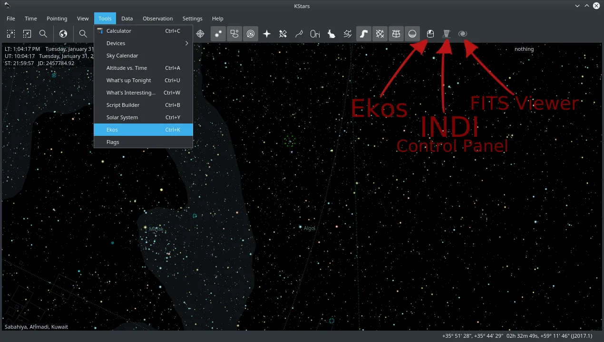
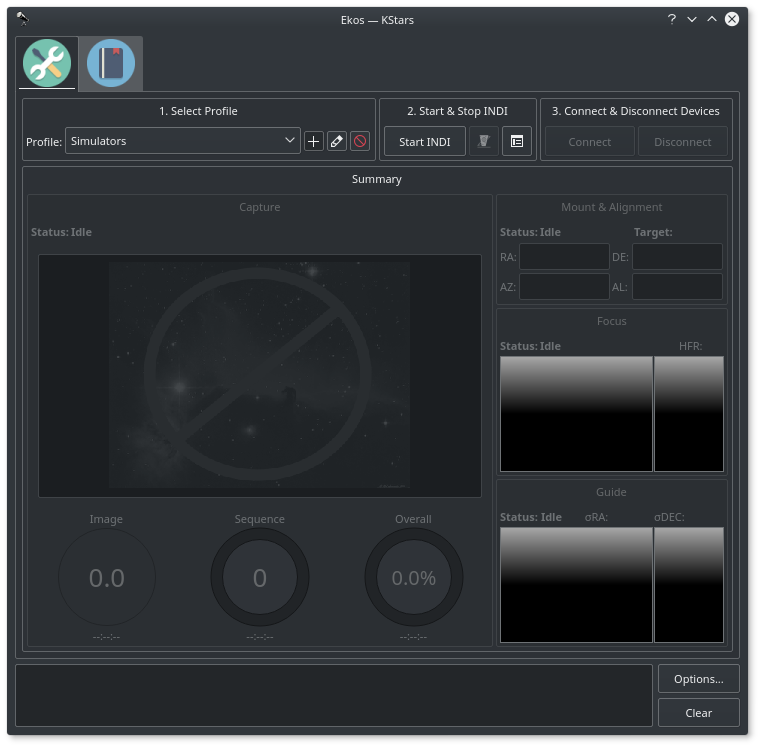
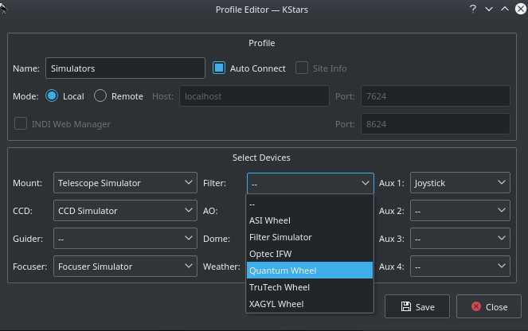
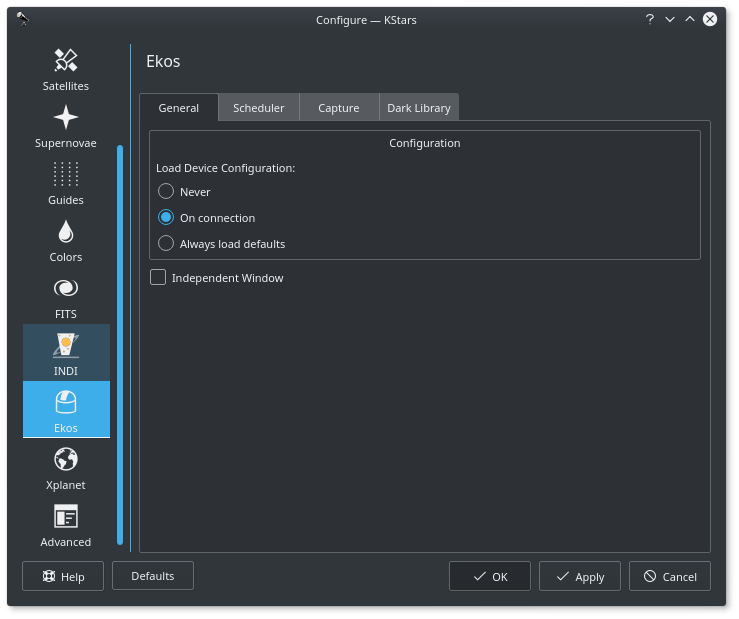
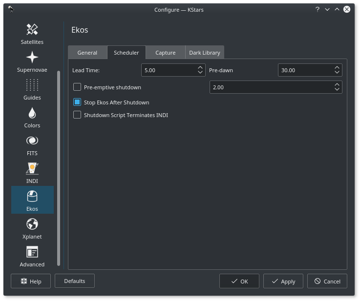
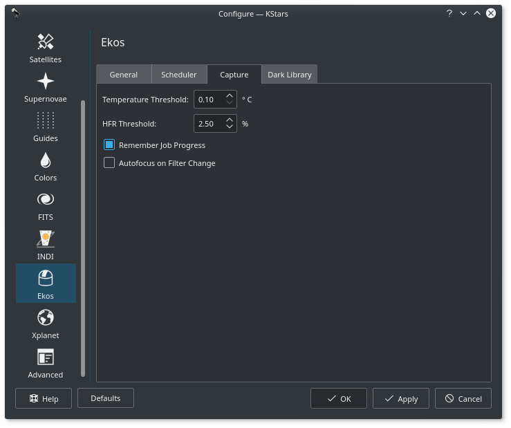
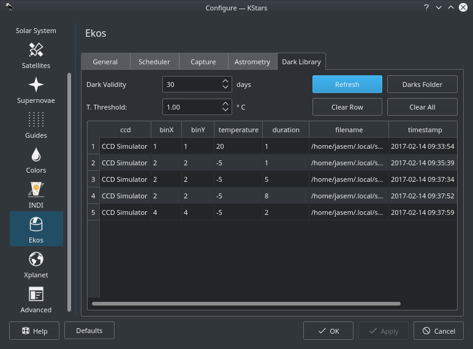

**Ekos** is shipped with KStars. After you run KStars, Ekos can be accessed from the **Tools** menu or via the Ekos icon on the main tool bar, or by a keyboard shortcut (Ctrl + K).

In addition to the Ekos window, KStars provides a more detailed INDI Control Panel where you can directly set and control the device parameters.

##  Ekos Setup

1.  _**Profiles**_: You can define profiles for your equipment and their connection mode using the _Profile Editor_. Ekos comes pre-installed with the _Simulators_ profile which can be used to start simulator devices for demonstration purposes:
    1.  **Connection Mode**: Ekos can be started either locally or remotely. Local mode is when Ekos is running in the same machine as INDI server, i.e. all the devices are connected directly to the machine. If you run INDI server on a remote machine (for example, on a Rasperry PI), you need to set the INDI server host and port.
    2.  **Auto Connect**: Check this option to enable automatic connection to all your devices after INDI server is started. If unchecked, INDI devices are created but not automatically connected. This is useful when you want to make changes to the driver (e.g. change baud rate or IP address or any other settings) _before_ you connect to it.
    3.  **Site Info**: Optionally, you can check the _Site Info_ checkbox and Ekos will load the **current** city and timezone whenever is Ekos is started with this profile. This can be useful when connecting to remote geographic site so that Ekos is in sync location and time wise.
    4.  **INDI Web Manager**: [INDI Web Manager](https://github.com/knro/indiwebmanager) is a web based tool to start and stop INDI drivers. It is usually installed on a remote embedded computer (e.g. Raspberry PI) where it can be used to start and stop the necessary INDI device profiles whenever required. If offers a more friendly and convenient method to start INDI server that does not require the user to login via [SSH](https://en.wikipedia.org/wiki/Secure_Shell) to the remote machine in order to start the INDI server manually. If you check this option, then Ekos will automatically start the selected profile on the remote INDI Web Manager. If the profile does not exist, then it is created and saved on the remote device. INDI Web Manager default port is _8624_.
    5.  **Device Selection**: Select your devices from each category. If the driver is only available on the remote machine and is not listed in Ekos, you can directly put its executable (e.g. indi_eqmod_telescope). Please note that if you have a CCD with a guide head, you can leave the guider dropdown menu _blank_ as Ekos will auto-detect the guide head from the CCD camera. Similarly, if your CCD includes embedded filter wheel support, then you do _not_ need to specify the filter wheel device in the filter dropdown menu.
2.  _**Start & Stop INDI**_: Start and Stop INDI services. Once INDI server is established, INDI Control Panel will be displayed. Here you can change some driver options such as which port the device is connected to ...etc.
3.  _**Connect & Disconnect Devices**_: Connect to INDI server. Based on the devices connected, Ekos modules (CCD, Focus, Guide...etc) will be established and available to use.

##  Ekos Options

Ekos options window can be opened either from Ekos Window or via KStars _Settings_ menu --> _Configure KStars..._ Most of the Ekos options display helpful tooltips that explain their functionality.

###  General

All INDI drivers supports loading and saving of INDI properties. For example, if you use a telescope driver, you can set your telescope aperture and focal length, and then save the configuration (under the Options tab) so it can be retrieved in a future session. The configuration option decides how to load the configuration file for INDI drivers:

1.  **Never**: Never load any configuration. The configuration can still be loaded manually in the INDI control panel.
2.  **On Connection**: Automatically load the driver's configuration on connection. This is the default behavior
3.  **Always Load Default**: Always load default configuration, if it exists

###  Scheduler

Set Scheduler Module options:

-   **Lead Time**: Lead time is the minimum time in minutes between jobs. The scheduler starts execution of a job before its scheduled start-up time by this lead time. Early execution is useful as focusing, alignment, and guiding procedures may take prolonged periods to time to complete.
-   **Pre-Dawn**: Do not permit jobs to be scheduled or executed past this many minutes before dawn.
-   **Pre-Emptive Shutdown**: In case no scheduler job is scheduled for this many hours, perform a complete shutdown procedure and restart observatory operations once the next job is ready.
-   **Stop Ekos After Shutdown**: Terminates Ekos when all scheduler jobs are complete.
-   **Shutdown Script Terminates INDI**: Check this option if you are using a shutdown script and if this script terminates INDI server as part of its operations. This is required to avoid displaying disruptive INDI server connection errors if INDI server termination was intended.

###  Capture

Set [Capture Module](/about/ekos/capture-module.html) options:

-   **Temperature Threshold**: Maximum acceptable difference between requested and measured temperature set point. When the temperature threshold is below this value, the temperature set point request is deemed successful.
-   **HFR Threshold**:Set HFR Threshold percentage gain. When an autofocus operation is completed, the autofocus HFR value is increased by this threshold percentage value and stored within the capture module. If In-Sequence-Focus is engaged, the autofocus module only performs autofocusing procedure if current HFR value exceeds the capture module HFR threshold. Increase value to permit more relaxed changes in HFR values without requiring a full autofocus run.
-   **Remember Job Progress**: When loading an Ekos Sequence Queue file (\*.esq) file, check if any jobs have already completed capture process and resume from where last capture was taken.
-   **Autofocus on Filter Change**: Perform Autofocus when changing filter wheels during exposure sequence.

 **HFR Threshold Example**: Suppose Autofocus operation completed and the last computed HFR value within the Focus module is 1.2 pixels. If the HFR threshold value is 2.5% (default), then the capture module's HFR value is updated to 1.2 + (1.2 \* 0.025) = 1.3 pixels. Thus, if In-Sequence-Focusing is enabled, then after an image capture is complete, the focus module shall capture an image and re-check if its HFR value is greater than 1.3 pixels. If it is larger, then an autofocus operation is started. Otherwise, the capture module resumes normally.

###  Dark Library

Ekos saves all dark frames in the Dark Library database so that they can be reused whenever required. In all Ekos modules (Focus, Guide, Align), a **Dark** checkbox is available to enable automatic dark frame substration for captured frames. Once a dark frame is captured, it is saved to disk (On Linux: ~/.local/share/kstars/dark) and the frame metadata is saved to the database.

Dark frames are therefore retained and reused whenever needed. By default, a dark frame is retained for 30 days before it is discarded. You can configure this value by changing **Dark Validity** option. Furthermore, dark frames are re-captured if either binning or temperature changes from the saved frame. By default, if the temperature differs by more than 1 degrees Celcius, then a new dark frame is captured. To control the temperature threshold, adjust the **Temperature Threshold** option.

When you first capture dark frame, Ekos shall ask you if your camera is equipped with a shutter (Mechanical or Electronic). This is a one-time question to identify the camera's capabilities. If the camera is equipped with a shutter, then Ekos shall proceed to capture the dark frame. Otherwise, Ekos shall ask you to cover the telesocpe or camera before capturing a dark frame.

A list of existing dark frames is shown in a table where you can delete row (and their associated dark frame) from the database or delete all data. Click **Darks Folder** to open the folder where all dark frames are stored. To view a specific dark frame within the FITS Viewer, simply double click on it.
