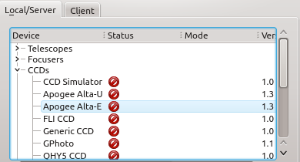

## What does INDI offer?

-   ### Open source

    INDI is released under the GNU Lesser General Public License (LGPL v2+), you can use and modify the source code to fit your needs in any environment.

-   ### Cross Platform

    INDI Library is a particular implementaion of the INDI protocol for POSIX operating systems. Currently, Linux, BSD, and OSX are supported. Windows support is under progress. Nevertheless, wINDI (3rd party software) is a complete .NET implementation of the INDI protocol and is available natively on Windows.

-   ### XML Based

    INDI is small and easy is parse. The INDI protocol can be nested within other XML elements such as RTML to add constraints for automatic scheduling and execution.

-   ### Client agnostic

    Clients learn the properties of a particular Device at runtime using introspection. This decouples the device driver implementation from clients. The device driver may be updated completely independent of the client.

-   ### Distributed control

    With INDI server/client architecture, you can communicate with devices either locally or remotely transparently. INDI accommodates intermediate servers, broadcasting, and connection topologies ranging from one-to-one on a single system to many-to-many between systems of different genre.

-   ### Wide range of support

    INDI supports many astronomical devices including telescopes, CCDs, focuser, spectrometers, and a lot more. Furthermore, INDI clients include popular astronomy software suites such as KStars, Xephem, SkyCharts, and CDC.
