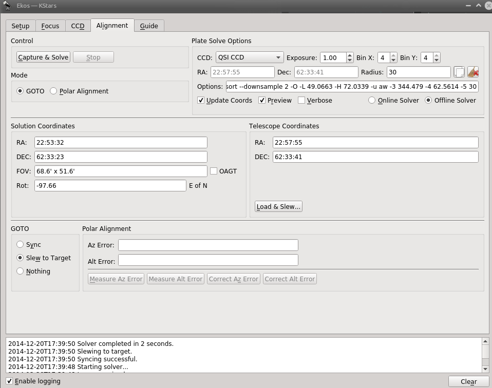

INDI Development team is happy to announce the release of INDI Library v0.9.9 on August 30th, 2014. Following are the highlights of this release:

-   Thread-safe INDI Library.
-   Support for Rigelsys NFocus Focuser driver.
-   3rdparty: Additional VID/PID for QHY.
-   3rdparty: added USB Bandiwdth control for ZWO Optical cameras.
-   3rdparty: Updated and improved INDI Apogee driver and Apogee Library major update.
-   3rdparty: Live preview support for GPhoto driver. Tested on Canon.
-   3rdparty: Various bugfixes and improvements in INDI SBIG driver including working guide chip support.
-   3rdparty: Fixed time drift error in EQMod. Added Horizon limits. Added Backlash compensation.
-   Updated and improved Image Agent.
-   Improved Astrophysics driver support.
-   Fixed location bug in Celestron GPS driver.
-   Additional information in FITS header such as filter name.
-   Joystick support for focuser and filter wheel devices.
-   Added option to enable local & remote save for FITS images in all CCD drivers.
-   Older V4L driver is deprecated (indi_v4l_legacy) and is replaced by indi_v4l2_ccd
-   V4L2: added recording (SER files) for use with Registax
-   V4L2: added RGGB & UYVY pixel format support to V4L2 drivers.
-   V4L2: fixed LX long exposure times.
-   Updated and improved tutorials.
-   Fixed few OSX compatibility issues.
-   Various bug fixes and improvements.

[Source](/download/source.html) and [Ubuntu packages](/download.html) are available for download.
