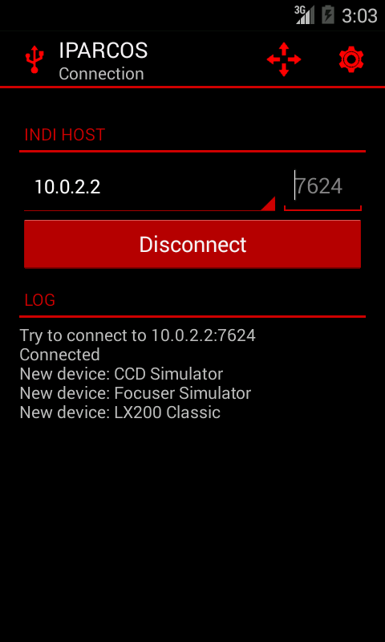
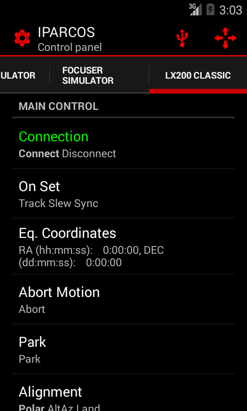

The first release of  IPARCOS (**I**ndi **P**rotocol **A**ndroid **R**emote **CO**ntrol **S**oftware) is available for download & testing. It features a generic control panel and others specialized tools to easily control your devices.

The project main site is [github.com/farom57/IPARCOS/](https://github.com/farom57/IPARCOS/)

**I. Features**

-   Generic control panel compatible with every devices (BLOB not yet supported)
-   Control of the telescope motion by means of a directional pad and speed buttons
-   Languages: English, French

 **II. Download and install**

-   From Google Play:
    -   Not yet available
-   From the .apk file:
    -   Check the release page on the github project to get the .apk: [github.com/farom57/IPARCOS/releases](https://github.com/farom57/IPARCOS/releases)
    -   You need to allow app installs from unknown sources in Android settings (Settings > Security > Unknown sources)

**III. Usage**

**1\. Prerequisite**

-   Minimum Android version: 4.0.3
-   An INDI server must be running on the remote computer.
-   You must have a network access to this computer.
    -   To achieve this, the Android device and the remote computer can be placed on your home network.
    -   Alternatively, you can create a wireless network with your Android device and connect the remote computer to this network (the PC address is likely to be 192.168.43.71)

**2\. Connection**

-   Choose the server address in the list or touch "Add server" to add a new server in the list
-   Optionally, you can change the port number if you do not use the default value for the INDI protocol (7624)
-   Click on "Connect"

**3\. Use the generic control panel**

-   Click on the gear icon in the action bar to display the generic control panel
-   Use the tabs to switch between the devices
-   The properties of the device are displayed in a list. Click on a property to edit it or show the details.

**4\. Control the telescope motion**

-   Click on the icon with four arrows in the action bar to display the telescope motion control panel
-   The buttons will be enabled (red) or disabled (grey) depending on the devices features.

    -   The arrows are enabled if one device provide the TELESCOPE_ABORT_MOTION, TELESCOPE_MOTION_NS and/or TELESCOPE_MOTION_WE properties
    -   The + and - buttons are enabled if one device provide the standard property to control the speed (TELESCOPE_MOTION_RATE) or the LX200 style property (Slew Rate) or the EQMod style property (SLEWMODE)
    -   If the device is not connected, the properties may not appears and the buttons will be disabled

**IV. Developed by**

-   **Romain Fafet** (farom57)
-   **Zerjillo**
    -   INDI for Java [www.indilib.org/develop/indiforjava.html](/about/news/112-indi-for-java.html)

**V. License**

The code is released under the GNU General Public License and is available at [github.com/farom57/IPARCOS/](https://github.com/farom57/IPARCOS/)
