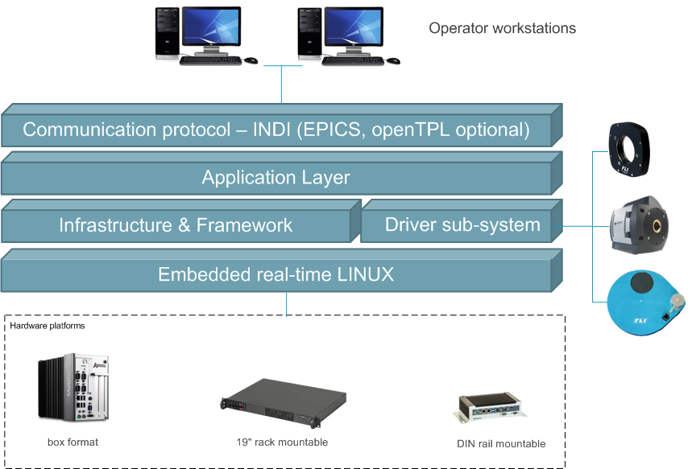
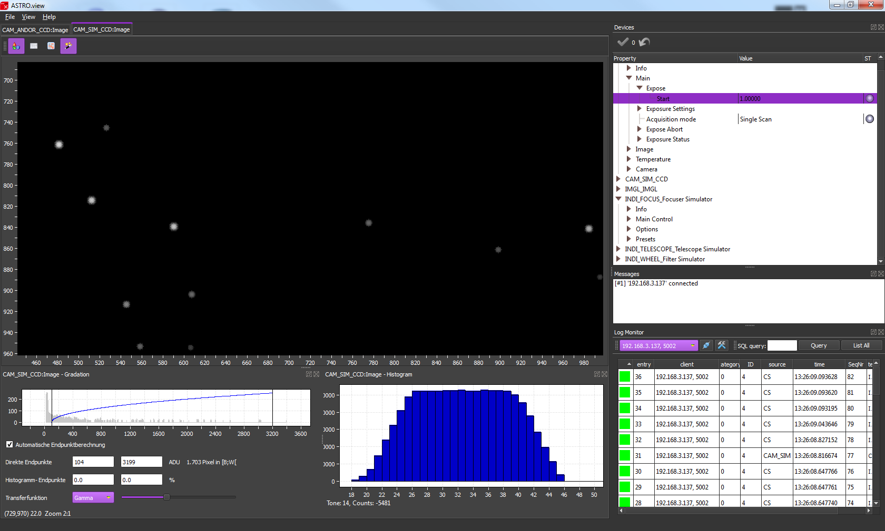
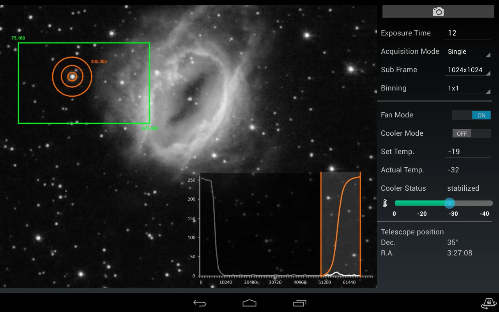

ASTRO.control, a generic platform for telescope and instrument control systems has been released by redlogix GmbH. The platform supports the INDI wire protocol and the INDI device architecture. A prototype of the system has presented to the community on the SPIE Astronomical Telescopes and Instrumentation in June 2014 in Montreal, Canada.

[redlogix](http://www.redlogix.de) is basically a software and system engineering company which specializes in development of control systems in areas like industrial automation, astronomy, robotics and others.

In the astronomy segment redlogix has contributed to ESO's VLT and VLT Interferometer since more than 15 years, to the flying infrared observatory SOFIA for more than 10 years, as well as to smaller telescopes. In these projects extensive experience has been gained with the development of custom specific telescope control systems and instrument control systems.

Only recently redlogix has concentrated all this know how in the development of a generic controller for astronomical devices, named [ASTRO.control](http://www.astrocontrol.de). It is based on a dedicated embedded Linux with real-time enhancement and runs on embedded industrial PCs of various form factors. The controller is designed to support any kind of astronomical devices, like filter wheel, focuser, mount, etc., with a focus on cameras. In particular the high-end Andor cameras are supported out of the box for various series, like iXon oder iKon. This controller product is now available on the market, as well as development services around the product and for general astronomical software, e.g. integration of specific devices, development of control application software, integration with specific observatory infrastructure, data aquisition or reduction software and such.

INDI has been chosen as communication protocol for both, operator workstation to controller communication, as well as inter-controller communication. Further, the INDI device concept is supported on the controller side. The INDI client and INDI wire protocol have been implemented for Windows, to enable Windows based GUIs. This component has now been published as [open source](http://www.astrocontrol.de/20_Components/80e_OpenSource.html) as a contribution of redlogix to the INDI community.

Why INDI? When designing the ASTRO.control communication protocol and device interface redlogix looked around for a suitable open standard in the astronomical sector, because they did not want to implement the N'th proprietary protocol. A lot of interesting concepts have been found, but no real wide-spread standard. The well-known ASCOM protocol is low level and for Windows clients only. What comes closest to a suitable standard and has already some distribution is INDI. So it was a strategic decision to support the INDI protocol and contribute to its further propagation. For more information please visit the [ASTRO.control](http://www.astrocontrol.de) website and the [redlogix](http://www.redlogix.de) web

