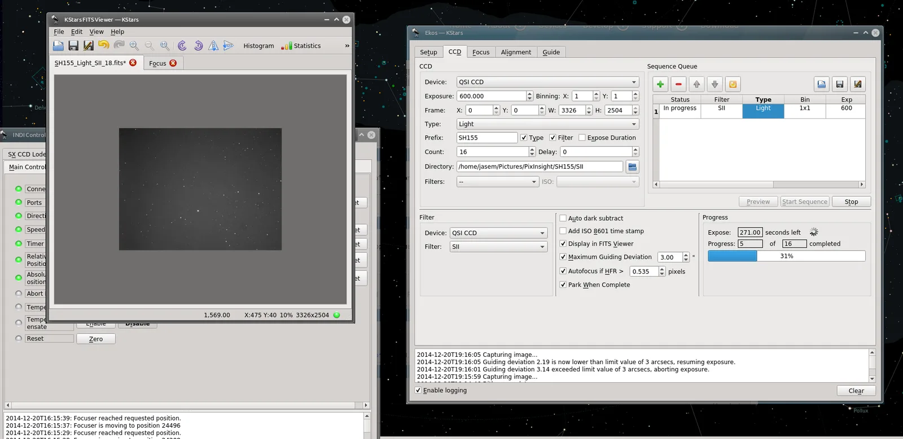

INDI Development team is happy to announce the release of INDI Library v1.2.0 on Feb. 2nd, 2016. Following are the highlights of this release:

From 1.1.0 to 1.2.0:

-   Support for Davis Vantage Pro/Pro2/Vue Weather Station.
-   Support for XAGYL Filter Wheel.
-   Support for Optec Flip Flat.
-   Support for Pulsar2 mount.
-   Support for JMI Smart Focus.
-   Support for GPS driver based on gpsd.
-   3rdParty: QHY Updates and Fixes. Color camera support.
-   3rdParty: GPhoto focus and live streaming fixes.
-   3rdParty: Starlight Xpress support for multiple identical devices and driver improvements.
-   3rdParty: ASI updated to latest SDK. Temperature readout for all cameras. ROI & Cooler fixes.
-   FocusLynx: Support 2 focusers.
-   Celestron: Support pulse guiding. Support hibernation and wakup on supported firmware.
-   SynScan: Complete rewrite to support latest features in the firmware.
-   GPhoto: Mirror lock support before capture.
-   RoboFocus: Update to comply to INDI::Focus standards.
-   SBIG: Support for connecting to Ethernet based CCDs.
-   ZEQ25: Updates and fixes.
-   MaxDomeII: Driver updated and tested under latest INDI::Dome standards.
-   QSI: Added anti-blooming option.
-   INDI WatchDog driver: Can be configured to perform observatory shutdown.
-   EQMod: Initial support for INDI Alignment Subsystem. Do not stop motor in low speed (guiding issue).
-   Temma: Complete rewrite based on INDI::Telescope and using INDI Alignment Subsystem.
-   AutoDome park feature in Dome devices.
-   Fix Crash on ODroid.
-   Added Meta-Weather driver to aggregate weather data from multiple sources.
-   Support for remotely controller dust caps and light box devices.
-   Handle 16bit images in Rapid Guide mode.
-   BaseClient non-blocking connect support.
-   Unified Streaming/Recording support for multiple drivers (ASI/QHY/V4L2).

[Source](/download/source.html) and [Ubuntu packages](/download.html) are available for download.
