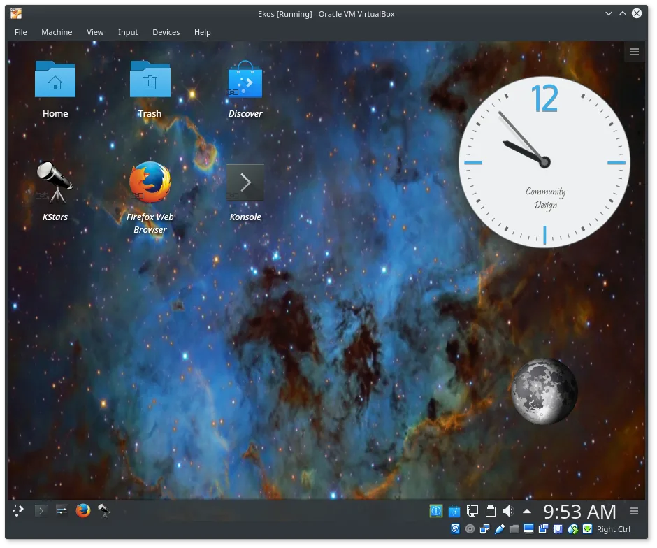

The INDI team is happy to announce the release of [Ekos VM 1.6](/download.html) on April. 16th, 2017.

Ekos VM is a virtual machine based upon Kubuntu 17.04. It Includes KStars, Ekos, and INDI Library including all 3rd party drivers. The VM includes the latest bleeding edge releases of Ekos & INDI, and can easily be updated whenever new builds of the software are available. This virtual machine is intended for new INDI users who want take a look to this software without the work of installing it in his own system or for users of other operating systems not supported by INDI. The virtual machine was created with VirtualBox but it is stored in the Open Virtualitzation Alliance (OVA) format so it can be used with different virtualization software.

The file size is large (~ 1.8 GB). **Please use a dedicated download manager for your browser** such as [DownThemAll](https://addons.mozilla.org/en-US/firefox/addon/downthemall/) for Firefox and ensure the downloaded file MD5sum matches the MD5 on the download page.

To get MD5sum, open a terminal and type:

```text
md5sum ekos.ova
```
