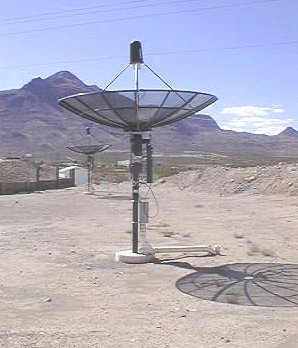

## What is Radio Astronomy?

Radio astronomy is a relatively new scientific discipline that employs radio waves to probe astrophysical phenomena from interstellar gas to extragalactic quasars. Since the dawn of radio astronomy in the 1930s, it has played a crucial role in developing our modern understanding of astrophysics. Most famously, the 2.725K cosmic microwave background (CMB) radiation was discovered by Penzias and Wilson at Bell Labs in 1965, using radio telecommunications equipment. Penzias and Wilson soon realized that the pervasive signal they were detecting in their antenna was the faint afterglow of the Big Bang, the very fires of creation. Radio telescopes are also responsible for the discovery of quasars (accreting black holes at the centers of distant galaxies) and pulsars (magnetized neutron stars, the remnants of exploded stars).

Perhaps even more significant than these famous discoveries of rare and exotic celestial objects, radio astronomy allows us to map out the distribution of cold hydrogen gas, the material from which all stars form.

## INDI Detectors

INDI is evolving fast, and gives every day a new chance for astronomers and amateurs to give their contribute in knowledge and passion.

Now INDI permits the exploration of the Universe in a wider range of the electromagnetic spectrum, ranging from visible, to infra-red, into the lower radio spectrum.

Some kind of devices, unlike CCDs, permit to observe in the elementary size of resolution: the single pixel. These devices are called by INDI _Detectors_.

The Detectors are of these kinds:

-   Radio Receivers
-   Photon Counters
-   Spectrometers
-   Light Detectors

With the Detectors many field of studies are available for exploration, ranging from:

-   Radio observation in both continuum and spectrum
-   Tracing light curves in variables and double-stars
-   High-speed and Classical photometry
-   Exoplanet hunting by spectral drift or occultation methods
-   Interferometry
-   Sun radio observations
-   3K Cosmic radiation studies
-   Pulsars, Quarks, AGNs
-   Other kind of studies

## The RTL-SDR Receiver

The first _Detector_ being implemented is a [software-defined radio](http://www.rtl-sdr.com/) based on the Realtek RTL2838 DVB-T dongle. These devices can range from 24MHz up to 2GHz raw reception. When connecting such dongles to [satellite dishes Low-Noise-Amplifiers](http://www.stargazing.net/david/radio/itty_bitty_radio_telescope.html), you can detect many extraterrestrial signals including pulsars. An [interferometer can be built](http://y1pwe.co.uk/RAProgs/index.html) using radio astronomy components to achieve this.

## SpectraCyber Receiver

The most abundant element in the universe is hydrogen. Hydrogen makes up 75% of the mass of baryonic matter in the universe, followed by helium at 23% , and all other elements at 2%. Due to its abundance, hydrogen has been studied thoroughly at its natural harmonic frequency of 1420 Mhz. By studying the kinematics and distributions of hydrogen clouds in the universe, we can gain a better understanding of the history and evolution of our galaxy and the universe overall.

INDI supports Radio Astronomy Supplies' SpectraCyber hydrogen line spectrometer @ 1420Mhz. The 1.42Ghz frequency or the 21cm line is being emitted by hydrogen clouds in the disk of the Milkyway. It supports all the functionality provided by the spectrometer including scanning continuum and spectral channels.

By gathering data from SpectraCyber, not only it is possible to construct contour maps of power densties of the galactic hydrogen distributions, but it is also possible to plot rotational velocities as a function of distance from the galactic center.

## AHP Interferometer

The AHP Interferometer is a pulse cross-correlator, that permits up to 16 independent pulse mode inputs.

Each input is then internally cross-correlated with each other line.

The correlator firmware code is applicable to a variety of FPGAs, and it is editable to best suite to the user needs.

Its characteristics are as follows:

-   Open Source Verilog firmare code
-   up to 16 independent input channels
-   cross-correlation on each baseline of the input channels
-   delay lines on each cross-correlation baseline and cross-correlation on each delay element
-   32 output switches (2 per channel)
-   UART messages with cross-correlation counts and pulse counts of each line for coherence calculation.

The INDI driver uses the CCD class to read the cross-correlations and coherence ratio of each baseline. By snooping a telescope, a GPS one can fill the Fourier plane in realtime and do model comparison, plane transformations in a latter time.

The INDI driver also uses DSP for immediate, in-driver analysis and plane transformations. One can use the single line's tab to enable it, power it when applicable to the hardware, read pulse counts and energy flux/magnitude estimations, obtain the delay line length in meters. Cross correlations are shown into the common Stats tab, and coherence ratios as well. Wavelength and bandwidth are selectable from the main tab.

To start an observing session, the driver needs the position of each line sensor (eye in the sky), the observed object coordinates and the wavelength/bandwidth observed.

This is suitable for both optical and radio observatories.

Also geiger mode revealers are compatible with the AHP interferometer, so cosmic ray observations can be done too.

The source code of the firmware is available here: [https://github.com/iliaplatone/interferometer](https://github.com/iliaplatone/interferometer)

## What's Next?

As we continue to develop the necessary software drivers to support radio astronomy detectors, we also plan to develop front-end clients in applications such as KStars to make radio astronomy accessible to more users across the globe. If you'd like to contribute to this ongoing project, please let us know in the [INDI Forums](/forum)!
