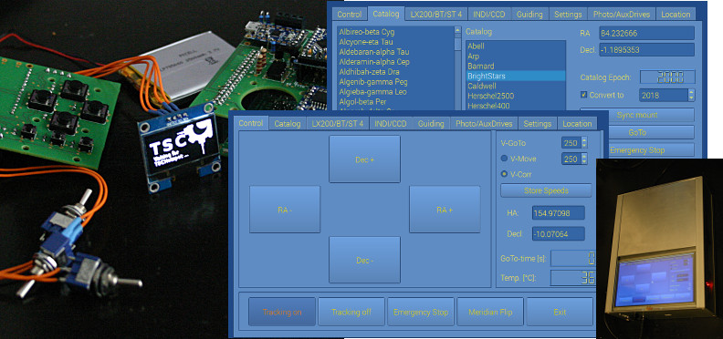

TSC is a project initiated about 1.5 years ago out of my frustration with available telescope controllers. My main instrument is a very heavy 13" catadioptric, stationary mounted on a rather large fork mount. The solution I had definitely choked on driving the NEMA 23 steppers with a maximum coil current of 2.8A. Thats where the idea for TSC was born, which is a controller based on a Raspberry Pi Model 3 B and two industrial drivers with a maximum voltage of 30 V and 4A per coil. Soon, the list of desired functions for a controller was defined:

-   Full motion control with a wireless handbox and WLAN-based communication with laptops, tablets or smartphones.
-   User - defined catalogs for standalone operation of the controller.
-   Full access for configuration via graphical user interface.
-   Communication with planetarium programs (e. g. KStars or CdC) over the classic LX200 interface via USB or TCP/IP. WLAN connection via SkySafari Pro is also supported.
-   Support for LX200 via ASCOM 6.3.
-   Support for external autoguiding via ST4.
-   Support for standalone autoguiding using INDI as an interface for common guiding cameras.
-   Control of DSLRs for single exposures and imaging series including dithering.
-   Optional support for up to two additional small focuser steppers.
-   Use of a battery-buffered realtime clock and parking to freely available reference positions.
-   Support for a temperature sensor.

Many more things are still in the queue, like scaled down driver boards for smaller mounts or GPS support for mobile use. However, TSC operates my telescope now for more than a year and a beta was released recently, which includes the C++ sources, all PCB designs in Fritzing format and Arduino IDE compatible MCU code for the additional microcontrollers. Upon request, an image of the modified Raspian stretch operating system with INDI installed is available so that basic fucntionality can be tested. Links to the github repository can be found under [https://tscatm.wordpress.com/](https://tscatm.wordpress.com/).

If you want to get a closer look on the project, a recommended starting point is the user manual: [https://tscatm.files.wordpress.com/2018/03/tscuserguide2.pdf](https://tscatm.files.wordpress.com/2018/03/tscuserguide2.pdf)

Wolfgang (wbirkfellner@gmail.com)
