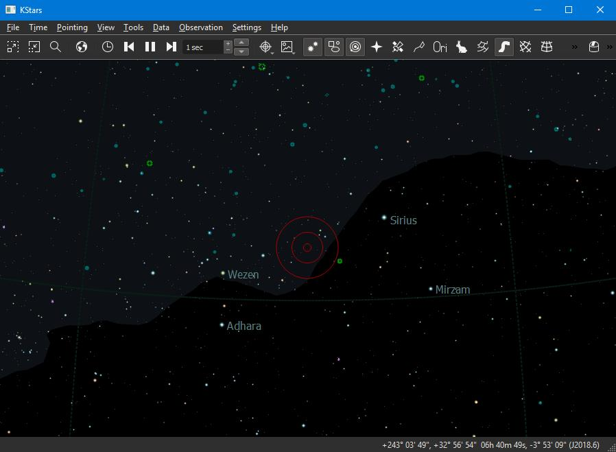
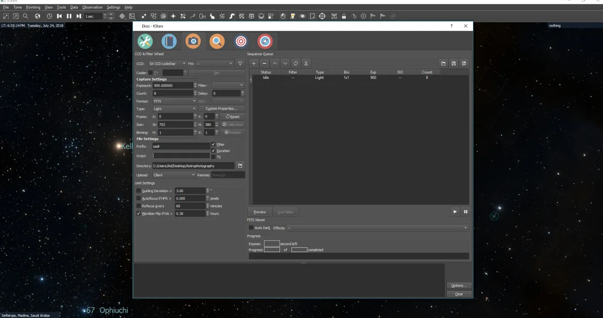
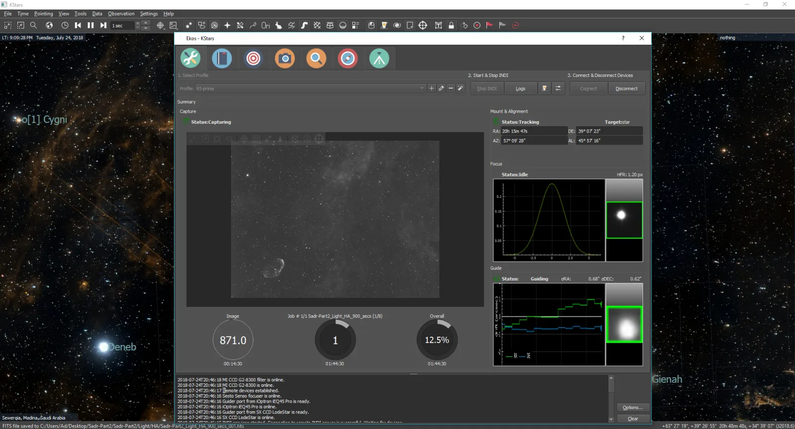
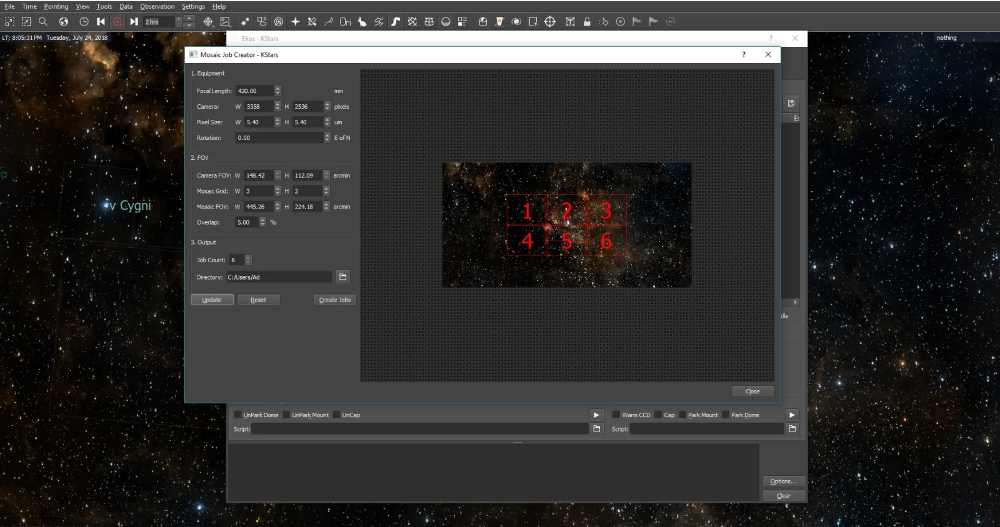
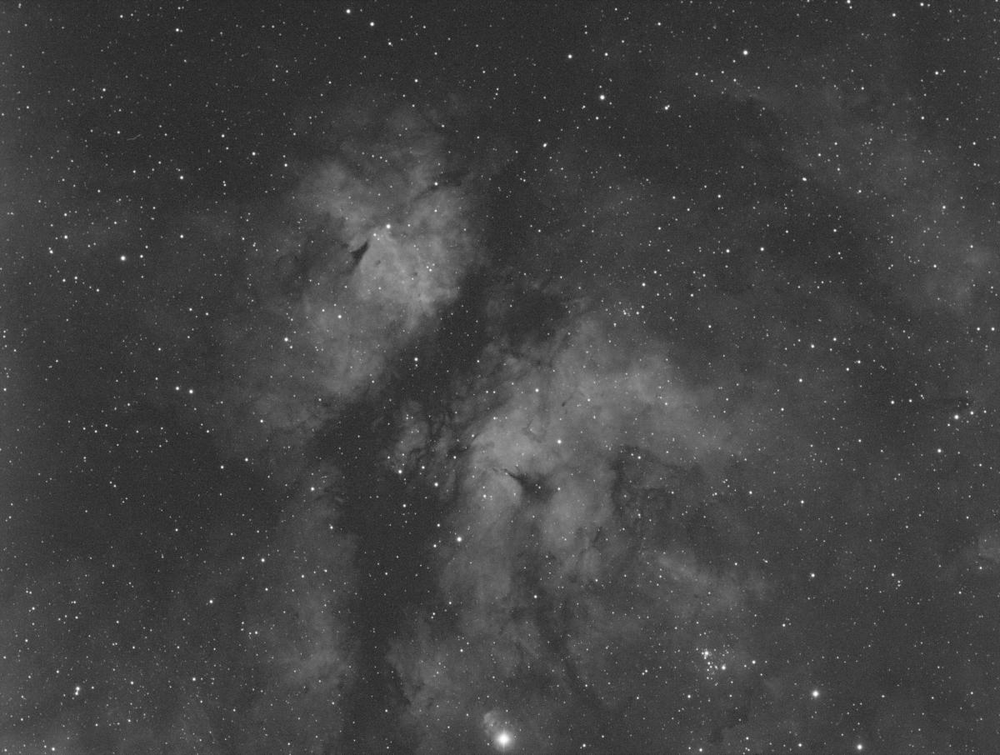
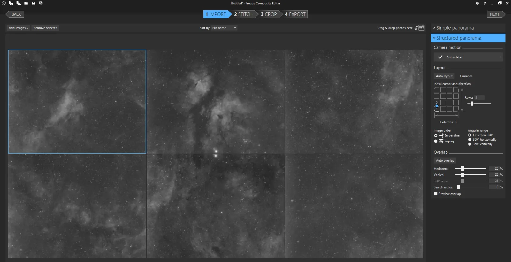
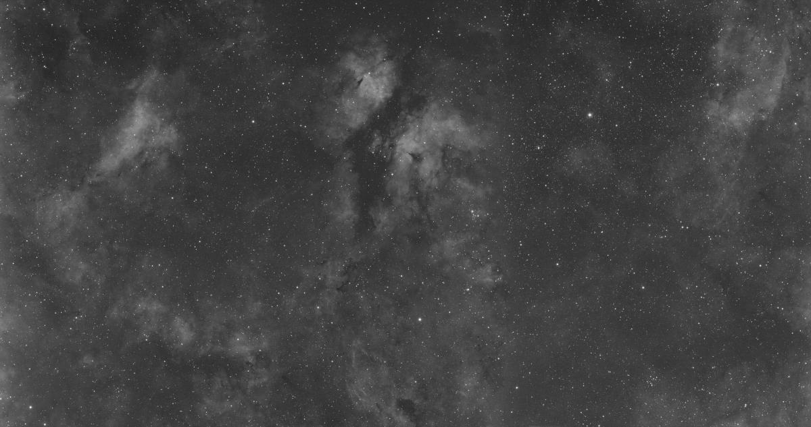
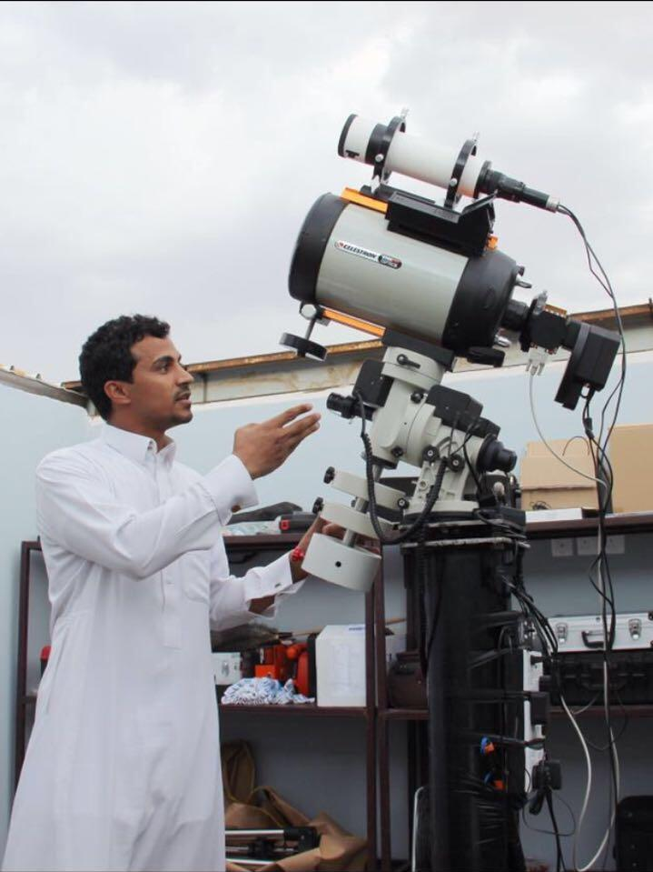

Up until 2017, I was using SGP to perform all my astrophotogrphy work. Along with PHD2, ANSVR, and PixInsight, I had a pretty good and established workflow for all my captures in my small observatory in Madina, Saudi Arabia. From a local gulf astrophotography group, I learned from Jasem Mutlaq about KStars/Ekos in mid 2017. Jasem was asking for some feedback on [KStars](https://edu.kde.org/kstars), and I downloaded it and gave it ago my Windows 10 system.

Frankly, I only spent a few minutes looking around, and it seemed like a rather simple program with limited functionality. It doesn't appear as _complex_ as SGP or MaximDL or SkyCharts, so I left it as is and went back to using my usual workflow. While I had many successful good runs, I had to spent a lot of time actively monitoring everything from guiding, to meridian flip (had to do it manually since I could never get to work with SGP), to eventual parking and shutdown of the system. Futhermore, the startup time was significant. Focusing took 10+ minutes to achieve decent results, and alignment only works partially as if the results are produced from the roll of dice. Fast forward to late 2017 where I began to look to for altentatives to expedite my workflow, and after a brief discussion with Jasem, I realized I completely missed the one feature of KStars I truely needed: [Ekos](https://stellarmate.com/support/ekos.html).

 

After watching a few Ekos videos online, I was thrilled about the potential. Alas, there is no native device support under Windows since Ekos depends on INDI, and INDI drivers are currently available for Linux & MacOS. This is the first time as a Windows user that I feel left out! The solution to this was [StellarMate](https://www.stellarmate.com). It is a small WiFi gadget with USB and Ethernet ports that you hook your astro equipment to. It's quite affordable (to think I was actually considering EAGLE2 a few months before!) and the setup is quite straight forward. Most of my equipment were already supported by StellarMate, with the exception of [Primaluce Sesto Senso](https://www.primalucelab.com/astronomy/sesto-senso-robotic-focusing-motor.html). After informing Jasem, he developed an INDI driver in just a matter of days! Afterwards, I was ready to begin my journey with StellarMate.

In addition to KStars & INDI, Stellarmate even comes preinstalled with a built-in astrometry solver. Ekos (KStar's Astrophotography Tool) is quite feature rich. No need to ditch extra $$$ for unlocking feature X or addon Y where such _additions_ are supposed to be part of the main program. StellarMate adopts a simple scheme, you pay once and you get all. This is probably a disasterous idea marketting wise (_Editor: I've been told that before!_), but excellent for us end users who do not need to battle endlessly with licenses and addons. Suffice to say, now Ekos sets the bar for what to expect of any astrophotography software. Besides the excellent support and fast response times the team behind Ekos & INDI are renouned for, I managed to automate my workflow.

Now focusing takes a couple of minute instead of 10+, auto meridian flip works like a charm with my iOptron mount. Remote solver is surprisngly fast, though it's not still as reliable as the online solver. The cream of the crop is Ekos Scheduler. It took me a few months to finally trust the complete workflow, but now my observatory is completely in the hands of Ekos Scheduler. I pick my target, select my sequence, and let it do its magic.

Recently, I wanted to compose a Mosaic of the [Sadr region](https://en.wikipedia.org/wiki/Sadr_Region) in Cygnus. With Moravian G2-8300 and Primaluce Airy 65 telescope, it would present a challenge to image Sadr's ~3 degree wide field of view. I fired up Ekos Mosaic Tool, and then with the HiPS overlay active, I created a 2x3 wide panel. For this to work correctly, all the camera & telescope information have to be up correct of course. After checking all settings and then clicking Create Jobs, Ekos created a patch of jobs for each region. It was then only a matter of starting to scheduler to get process rolling. Since I didn't put any constraints on startup times, it began the startup procedure as soon as one the target regions was above the minimum altitude limit of 30 degrees (_Editor: which is configurable_).

The schduler unparks the mount, slew to one of the regions, then it performs the usual Focus & Align & Guide steps before starting the capture process. Using the scheduler relieved a significant amount of time I was investing in getting everything in order before I was able to properly capture before. Of course, it's not all sunshine and roses. There are some occasional bugs that creep by, which I usually report to Jasem along with a copy of the logs. Over the last few months, I've seen Ekos grows more stable and reliable thanks to the efforts of an international team of volunteers across the globe. The last bit in my observatory that is not automated is my roll-off roof. As soon as I complete its integration with INDI, I can proudly say I have a truely robotic setup!

Now back to the Mosaic images, I only captured this patch in Hydrogen Alpha filter. This is a sample of a single frame:

Then I used Microsoft Composite Editor to stich them togeather. While I could have used PixInsight, I wanted something quick to check the results:

Here you is the final result for HA. You can check the full resolution image at 8395x4435 on [AstroBin](https://www.astrobin.com/357647/).

Now with this nice result, I plan on capturing the mosaic in other filters to create a color composite.

Update 2018-08-15: Here is the final color composite:

My name is Turki AlAmri, and I am health care provider with a strong passion for astrophotography.

I work from my own neck of the desert in Madina, Saudi Arabia where I continue to pour money, time, & effort into this hobby along with phonomenal patience and support from my beloved wife. You can find more about me on [Instagram](https://www.instagram.com/astroturki/) & [Twitter](https://mobile.twitter.com/tualamri?lang=ar).
