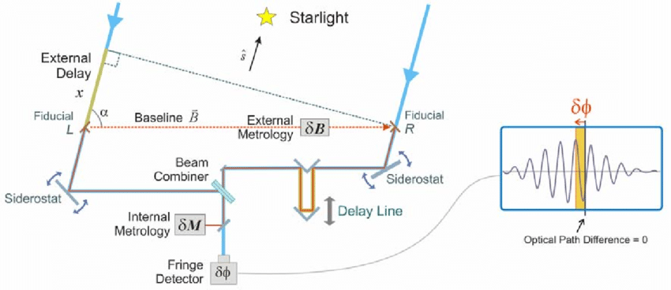
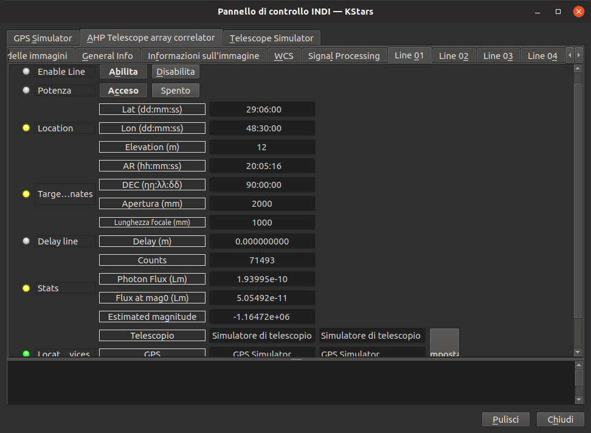
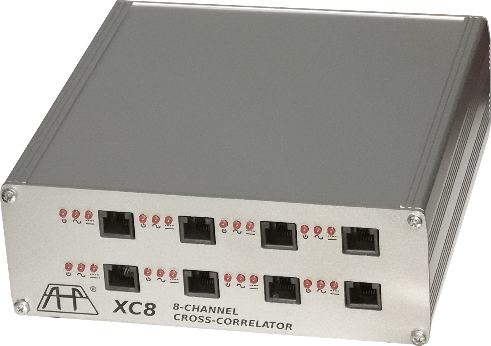
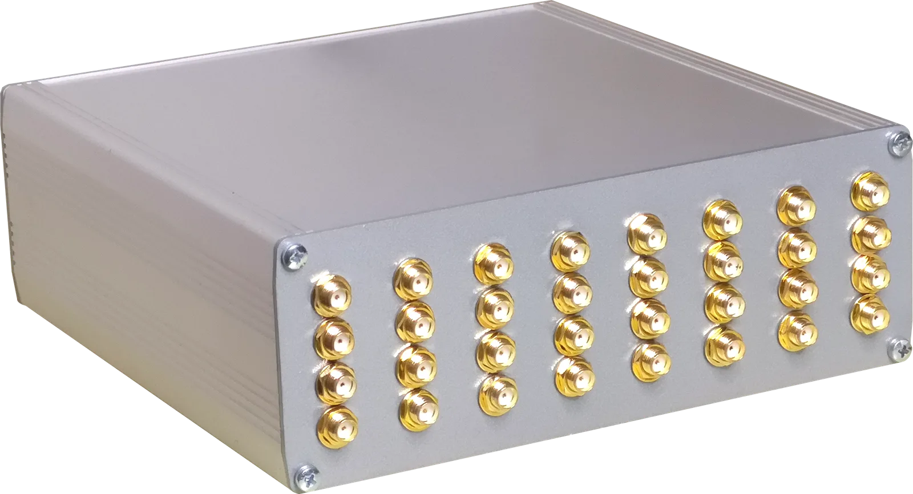

Many amateur astronomers have seen movies like Contact, Deep Impact, The Dish and similar movies, getting inspired in Astronomy and beginning their nightern journey.

I personally, except Sci-Fi and educational movies like these, was impressed by many documentaries about astronomy that talked about joining together many telescopes into one giant eye that watches towards the sky with extreme resolutive capabilities.

The technique that permits to achieve this is Interferometry, that consists into the calculation of interference between signals of different fluxes (optical, radio, pulsative) such to obtain the correlation level between them: the similarities in certain conditions. Such conditions, in astronomy, can be the perspective, the parallax, the location of the telescopes on behalf the subject observed. The more the signal is strong in such of these conditions, took note of them, the more the signals of them are similar. This is not so easy to understand at first read, but follows furhter explanations.

After many years of studies, searches and many tries, I got the opportunity to start to build a device that helps amateur astronomers to build their own array.

The device is a correlator, which is used into particle physics laboratories like the Super Kamiokande in Japan, Cherenkov arrays like the VERITAS array, radio dishes or antennas arrays like the ALMA array in Chile.

The correlator is a part of an interferometrical system, allowing to join the fluxes of the telescopes and to report back their correlation degree instantly.

The rest of the system is the hardware antennas or telescopes, the mounts, the GPSes and the visualization PC. INDI has a driver for the correlator.

The correlator is the AHP XC8, it allows to connect up to 8 telescopes, and to obtain 28 baselines between them.

The total diameter of a single telescope obtained with the array will be the maximum baseline (perspective distance) of the telescopes location. Watching a star at Zenith, with a telescope at East and a telescope at West distant 100 meters will result to a single telescope of 100 meters of diameter.

The resolution of these arrays will depend on the frequencies, for example watching at 1420MHz the resultant resolution will be 18 arcmin/pixel while using optical sensors with a green filter the resolution reaches 2.5 milliarcsec/pixel. Just for comparison a 200mm telescope has the resolutivity of about 0.6 arcsec/pixel on the visible spectrum.

The INDI driver, at experimental stage, permits to obtain a picture of the sky directly after an observation.

The AHP XC8 is also capable to do spectrography, it allows to receive from radio sensors, optical single-photon sensors, and to power them up or to link a line using its global pass-through line.

The specifications:

-   DIN8 Backport for serial communication, clock tuning and frame sync
-   8 TTL inputs
-   10ns minimum pulse width
-   count rates up to 100MHz
-   24 bits sampling capacity
-   1 million spectral channels
-   Real/imaginary spectral reports
-   Real/imaginary cross-correlation reports
-   independent delay lines selection for autocorrelator and crosscorrelator modes
-   28 baselines
-   External true-bypass line for HSP17 photomultiplier assemblies power supply or others
-   57.6, 115.2, 230.4, 460.8 Kbaud sampling frequency
-   Direct reading of pulse counts, autocorrelation and crosscorrelation counts
-   SMA standard TTL3V3 connectors
-   Open Source SDK

The AHP XC32 is instead a 32-input multichannel cross-correlator and spectrograph.

The specifications:

-   DIN8 Backport for serial communication, clock tuning and frame sync
-   32 TTL inputs
-   10ns minimum pulse width
-   count rates up to 100MHz
-   24 bits sampling capacity
-   1 million spectral channels
-   Real/imaginary spectral reports
-   Real/imaginary cross-correlation reports
-   independent delay lines selection for autocorrelator and crosscorrelator modes
-   496 baselines
-   57.6, 115.2, 230.4, 460.8 Kbaud sampling frequency
-   Direct reading of pulse counts, autocorrelation and crosscorrelation counts
-   SMA standard TTL3V3 connectors
-   Open Source SDK

Ilia Platone.
