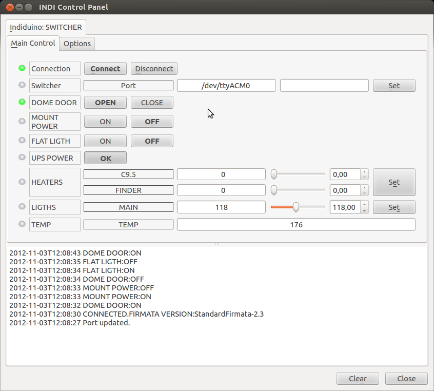

INDIDUINO is a combination of hardware and drivers aims to fulfill miscellaneous automation functions on robotics telescope observatories. By mean of INDIDUINO boards and drivers you can switch on/off elements, obtain status and values from digital/analog inputs or event actuate servos.

Taken advantage of the great flexibility provide by both, arduino and INDI protocol, indiduino boards/drivers acquires its personality at runtime reading a xml files that define each arduino PIN behavior (Digital Input, digital output, PWM, Analog input). Thus is possible to make a plethora of hardware devices suitable for almost any propose.

The underlying technologies are [Firmata](http://www.firmata.org/wiki/Main_Page), [Arduino](http://www.arduino.cc/) and [INDI protocol](/). At this moment INDI platform is only available for Linux.



Indiduino is developed and maintained by [Nacho Mas](/about/contributors/13-nacho-mas.html). For more up to date information visit [INDIDUINO specialize site](http://indiduino.wordpress.com).

By default, the INDI INDUINO driver runs Simple Switcher skeleton. If you want to run another skeleton file, you must set the environment variable before running INDI server.

For example, to run INDUINO driver with stepper skeleton:

```shell
export INDISKEL=/usr/share/indi/stepper_sk.xml
indiserver -v indi_duino
```
