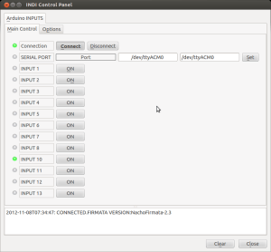

Read up to 12 digital inputs.

Adapting electronic is not need if the inputs are already TTL (0V->OFF, 5V-ON). If its not the case add additional circuits as needed.



```text
To install on your computer see How to Install Drivers
Arduino firmware: StandardFirmata-2.3
skeleton file: digital_inputs_sk.xml
Customize your device editing skeleton file and change "INPUT 0" for the real name of the input plugin
```
