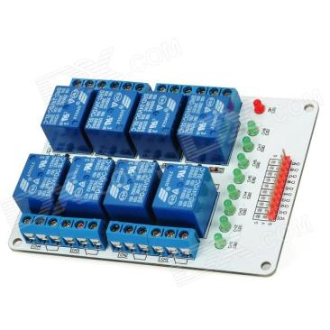
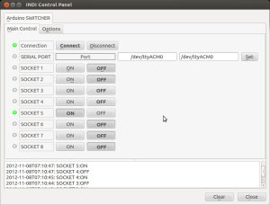

This is the easy one. Switch on/off your loads connecting your arduino board to a relay board like this one:



You can switch on/off up to 8 loads each within this limits AC 250V/10A or DC 30V/10A. Connect arduino pins from 2 to 8 to the relay board channels 1 to 8 and also VCC and GND arduino pins to VCC/GND pins

[See hardware  in Dealextreme](http://dx.com/p/arduino-compatible-8-channel-24v-relay-module-expansion-board-145731?utm_source=dx&utm_medium=edm&utm_campaign=20120802)

```text
To install on your computer see How to Install Drivers
arduino firmware: StandardFirmata-2.3
skeleton file: switcher_sk.xml
```



```text
Customize your device editing skeleton file and change "SOCKET 0X" for the real name of the device plugin
```
