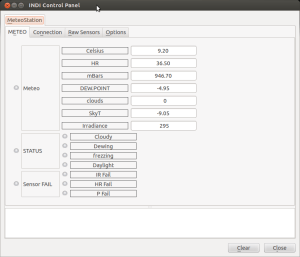
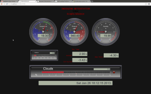

Every observatory need a meteostation thus here is the induino version!

Features:

-   High precision barometer.
-   Relative Humidity (HR) reading.
-   Dewpoint calculation.
-   Far sky temperature using Infrared Thermometer for determining cloud cover.
-   Photocell to read sun radiance levels.
-   One internal thermometer.
-   Two external thermometer.
-   Clouldy, dewing, freezing and daylight digital flag.
-   Sensor malfunction flags.
-   [Web Interface](http://indiduino.wordpress.com/2013/02/03/meteostation-web-interface/ "Meteostation. Web Interface") with historical data.

Visit this [page in Indiduino](http://indiduino.wordpress.com/2013/02/02/meteostation/) site for detail information
