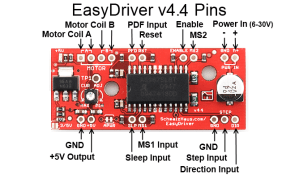
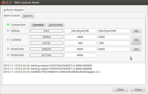

##  Stepper

Controlling a stepper motor could be great for move several precision mechanical devices such focuser, filterwheel, etc.. In this example we use a **modificated firmware** for controling a stepper motor througth a [EasyDriver Board](http://www.schmalzhaus.com/EasyDriver/).

First of all you have to flash your arduino with INDIDUINOStepper.ino firmaware. This firmware include some  functions to cach the standard firmata behaviour and doing something more elaborated. We also use a Arduino  [AccelStepper library](http://www.open.com.au/mikem/arduino/AccelStepper/) called from this custom firmware, thus it must be installed on your system.

Then connect the easyDriver to the VCC/GND and the coils of your stepper. Read EasyDriver documentation to do this. Finally connect  arduino pins to the easydriver control signals in this way:

-   pin 9 -> steps
-   pin 8 -> dir
-   pin 7 -> sleep





```text
Arduino firmware: INDUINOStepper-2.3
skeleton file: stepper_sk.xml
```
