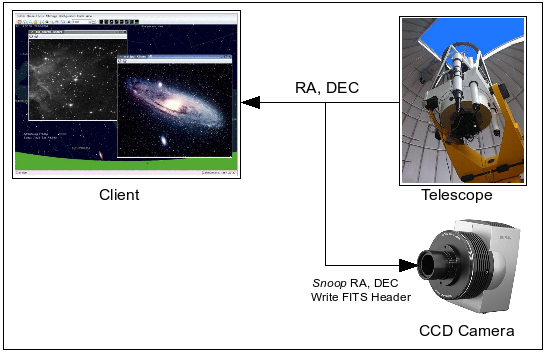

INDI Library provides the facility to _snoop_ on properties in other drivers. This permits robust inter-driver communication that can be useful in many applications. Typically, all the properties defined by a driver are available for snooping by other drivers. Therefore, all drivers are by default _publishers_, whereas the snooping drivers are _subscribers_.



When a subscriber driver needs to subscribe to a property, it calls an API function with the snooped (publisher) device and property names:

`IDSnoopDevice (snooped_device, snooped_property)`

Whenever the snooped_device updates its snooped_property, the INDI framework notifies the subscriber of the change by calling the ISSnoopDevice() function which is defined by the subscriber driver.

In ISSnoopDevice, the driver receives an XML element for the new property value which it can pass to a number of handy utility routines for processing and information extraction.

For instance, suppose a driver defines a simple switch FOO:

```text

ISwitch FooS[] = {"FOO", "", ISS_OFF, 0, 0};
ISwitchVectorProperty FooSP = { "FOO Device", "FOO Switch", "", FOO_GROUP, IP_RW, ISR_1OFMANY, 0, IPS_IDLE, FooS , NARRAY(FooS), "", 0};
```

The subscriber driver needs to call IDSnoopDevice("FOO Device", "FOO"); to get notified of any changes to the switch.

How can the subscriber driver read the status of the FOO switch? Suppose _FOO Switch_ got updated and we received the XML update:

```text

On

```

There are two methods to read the snooped property into the subscriber driver:

-   The subscriber driver processes the root XML elements for properties it is interested in fetching:

    In ISSnoopDevice, we can have the following:

    ```cpp

    void ISSnoopDevice (XMLEle *root)
    {
       const char *propName = findXMLAttValu(root, "name");
       if (!strcmp(propName, "FOO Switch"))
       {
          XMLEle *oneSwitch = findXMLEle(root, "oneSwitch");
          if (!strcmp(pcdataXMLEle(oneSwitch), "On")
              IDMessage(mydev, "Foo is ON!");
          else
              IDMessage(mydev, "Foo is OFF!");
       }
    }
    ```

-   The subscriber driver keeps a _carbon_ copy of the snooped property definition so that it can use the utility functions to fetch the XML element into it. The subscriber driver simply needs to copy that definition to its source file

    In ISSnoopDevice, we can have the following:

    ```cpp

    void ISSnoopDevice (XMLEle *root)
    {
       if (IUSnoopSwitch(root, &FooSP) == 0)
       {
           if (FooS[0].s == ISS_ON)
              IDMessage(mydev, "Foo is ON!");
           else
              IDMessage(mydev, "Foo is OFF!");
        }
    }
    ```

In addition to snooping on text, number, switch, and light properties, the subscriber driver can also snoop BLOBs sent by other drivers. Like clients, it can select how it receives BLOBs. The driver can choose to never receive BLOBs, or receive them intermixed with other traffic, or exclusively receive BLOBs while ignoring all other type of traffic.

Refer to the inter-driver communication tutorial under the examples directory of INDI for a typical implementation involving a dome driver that monitors the status of a rain collector. The dome driver subscribes to a LIGHT property called rain collector in the rain driver. When the property changes its status to alert, the dome driver promptly closes down the dome.
