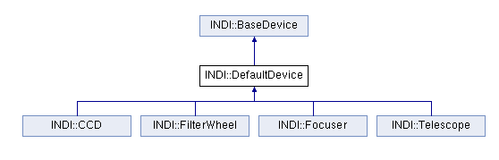

An INDI driver is what directly communicates with your device(s). An INDI driver may control one or more hardware devices. It is responsible for controlling the device, and for representing the device properties to clients using INDI's protocol structures. The driver _does not contain_ a main(), as it is expected to operate in an event-driven fashion. The core device class is [INDI::DefaultDevice](/api/classINDI_1_1DefaultDevice.html), and it encapsulates the functionality of the most basic INDI device driver.

The driver must implement each [ISxxx()](/api/group__dcuFunctions.html) function but never calls them. The IS() functions are called by the reference implementation main() as messages arrive from Clients. Within each IS() function the driver performs the desired tasks and then may report back to the Client by calling the [IDxxx()](/api/group__d2duFunctions.html) functions. The INDI library provides routines for common tasks such as serial communication, string formatting & conversion, and XML parsing. libnova, an external optional library, provides facility for astronomical calculations, while cfitsio provides handling for FITS files.

The reference API provides [IExxx()](/api/group__deventFunctions.html) functions to allow the driver to add its own callback functions if desired. The driver can arrange for functions to be called when reading a file descriptor that will not block; when a time interval has expired; or when there is no other client traffic in progress. Several utility functions to search and find INDI vector structs are provides for convenience in the API. The sample indiserver is a stand-alone process that may be used to run one or more INDI-compliant drivers. It takes the name of each driver process to run from its command line arguments. Once a binary driver is compiled, indiserver can load the driver and handle all data steering services between the driver and any number of clients.

The [INDI::Telescope](/api/classINDI_1_1Telescope.html), [INDI::CCD](/api/classINDI_1_1CCD.html), [INDI::Focuser](/api/classINDI_1_1Focuser.html), and [INDI::FilterWheel](/api/classINDI_1_1FilterWheel.html) classes provides the standard interface for those classes of devices. You need to subclass those classes in order to develop a driver for your device. If you device does not belong to those classes (i.e. weather station, or rain detector), then you may subclass INDI::DefaultDevice directly.

The device properties may be either hard-coded in the driver's code, or stored externally in a skeleton file. Which method you opt to utitlize depends on your preferences & devices. Drivers utilizing skeleton files have their properties stored in an XML file (usually under /usr/share/indi in Linux). The skeleton file naming convention is driver_name_sk.xml. For indi_spectracyber it is indi_spectracyber_sk.xml. The contents of the skeleton file is a list of defXXX XML statements enclosed by <INDIDriver> opening and closing tags. Support for automatic auxiliary controls Driver may add debug, simulation, and configuration controls to the driver by calling addAuxControls(). For each driver, you must provide the device's default name and driver version information.

Tutorial Four is a simple driver to illustrate the skeleton method. Please make sure to install tutorial_four_sk.xml to /usr/share/indi or define INDISKEL envrionment variable to the path of this file before running the tutorial.

INDI Library uses CMake build system, please refer to the CMakeLists.txt file shipped with libindi and 3rd party drivers.
