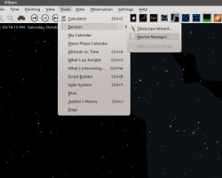
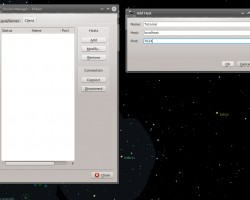
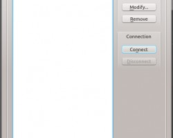
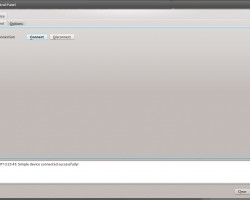

INDI Library currently ships with seven tutorials in the _[examples](/api/examples.html)_ subdirectory. To build the tutorials, first install some pre-requisties on Ubuntu:

```shell
sudo apt-get install cdbs cmake git libcfitsio-dev libnova-dev libusb-1.0-0-dev libjpeg-dev libusb-dev libftdi-dev fxload libkrb5-dev libcurl4-gnutls-dev libraw-dev libgphoto2-dev libgsl0-dev dkms libboost-regex-dev libgps-dev libdc1394-22-dev
```

Then checkout INDI Library code from Github and build it:

```shell
mkdir ~/Projects
cd ~/Projects
git clone https://github.com/indilib/indi.git
mkdir -p build/indi
cd build/indi
cmake -DCMAKE_INSTALL_PREFIX=/usr -DCMAKE_BUILD_TYPE=Debug ~/Projects/indi
sudo make install
```

To run tutorial one for example, simply run:

```shell
indiserver -v examples/tutorial_one/tutorial_one
```

This will create an INDI server running tutorial one driver on port 7624 (by default) on the local machine. You can connect to the INDI server using any INDI compatible client such as KStars. If you are using KStars, perform the following steps:

1.  Select the _Device Manager_ menu item from the _Tools_ menu

    [](/images/kstars/kstars_dm_part1.png)

2.  Select the client tab and add a new host

    [](/images/kstars/kstars_dm_part2.png)

3.  Click _Connect_ in the device manager to connect to INDI server running Tutorial One

    [](/images/kstars/kstars_dm_part3.png)

4.  Client Connect/Disconnect to test tutorial one simple functionality in INDI Control Panel

    [](/images/kstars/kstars_dm_part4.png)

The INDI Library tutorials cover some of the basic aspects of INDI, namely:

| Tutorial | Driver | Description |
| --- | --- | --- |
| One | Simple Device | The most simple INDI driver. The tutorial covers what is required to build and run a minimal INDI driver. |
| Two | Simple Telescope | Implementation of a simple telescope driver using INDI event-driven framework |
| Three | Simple CCD | Implementation of a simple CCD driver that sends a randomly generated image to the client as FITS. |
| Four | Skeleton | Demonstration on how to utilize INDI's skeleton files to build driver properties externally. |
| Five | Rain and Dome | Demonstration of INDI Snooping functionality that enables inter-driver communication. |
| Six | Client Application | Implmentation of a simple client application that can connect to the Simple CCD driver and controls its temperature. |
| Seven | Advanced Telescope Simulator | Sample implementation of a telescope driver that utilizes INDI's Alignment Subsystem Infrastructure |
