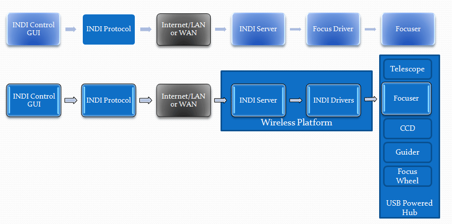

Page 1 of 4

## Introduction

There’s always point where you have to decide in any expensive undertaking, such as amateur astronomy, where it’s best to apply your hard earned currency. For any given piece of equipment, you have to determine what feature set is required, decide what commercial products, if any, suit your needs and finally, what your best purchase option may be. For me, there’s always been a desire to see if I can build a more cost effective solution first, before I proceed to purchase.

With that in mind, it’s been my goal for some time, to complete my automated and remote solution for my personal astronomical observatory. Not having found a cost effective remote focusing solution on the market, I decided to see about low cost DIY alternatives. During my search and evaluation I turned to the INDI platform for ideas.

My project goals were simple; I must have the following:

1.  Reduced complexity, easy to build.

2.  INDI platform compatibility. As a result, the basic solution should be deployable to any UNIX/POSIX based system.

3.  The ability to remotely support main scope focus, as well as a guide scope.

4.  Applicable to commercially available SCT scopes Meade, Celestron and guide scopes such as Orion 80ED.

5.  Use of Continuous Rotation Servos as an alternative to the higher cost, increased complexity and power requirements of a stepper based solution.

6.  Adjustable speed control.

7.  Keep It Low cost.

8.  Wireless Capability.

The ultimate desire was to have all of the above, yet have a completely integrated hardware and software interface to all of my equipment. INDI, it seemed, provided all of the features needed for imaging, guiding, tracking, control and focus in one integrated software solution, provided that my devices were all supported. They were, except for driver support for the servo based focuser I had envisioned.

No problem here, I decided, I would create my own software driver based on the excellent examples provided by the INDI site.

How did I put all of this together? I actually created two solutions, one direct wired via USB and one wireless solution:

My solution utilizes an Arduino UNO board with a simple wiring diagram to interface directly to 2 servos. It’s really quite simple, and should work with any Arduino board that can drive a servo. In my ‘direct connect’ solution which was used for testing, I connect directly to the Arduino board using a USB cable and a local indiserver instance running on the same Linux based PC as the INDI client. For deployment, I installed the INDI platform and INDI server to a Raspberry PI Rev2 and use an 802.1n USB dongle to provide remote/wireless capability to allow remote access from anywhere on my local network. First, a little bit about servos. I used ‘standard’ servos which are of a size and shape similar to those seen on hobby RC airplanes. There, the similarity ends, as RC controlled airplanes use limited travel angle servos. Their control protocols are very much different from continuous rotation servos and are not suitable for this application.

NOTE: This solution and software driver absolutely will not work with limited travel angle servos without necessary changes to the driver (and maybe not even then). The servos used for this solution must be ‘continuous rotation’. They’re available for around $9.00 USD or maybe less from vendors such as Parallax or Futaba etc.
