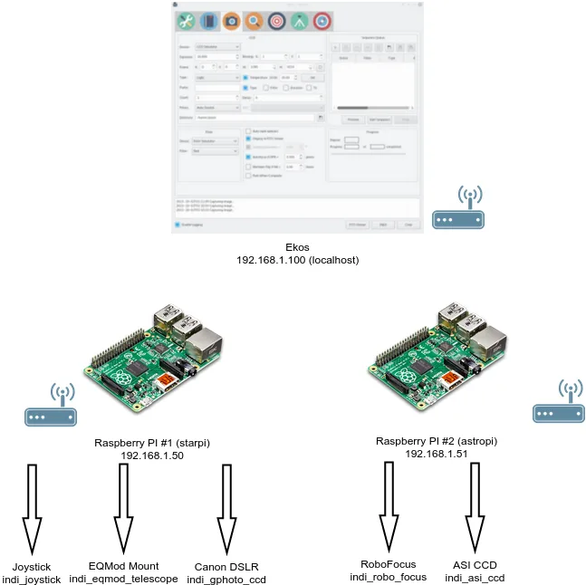
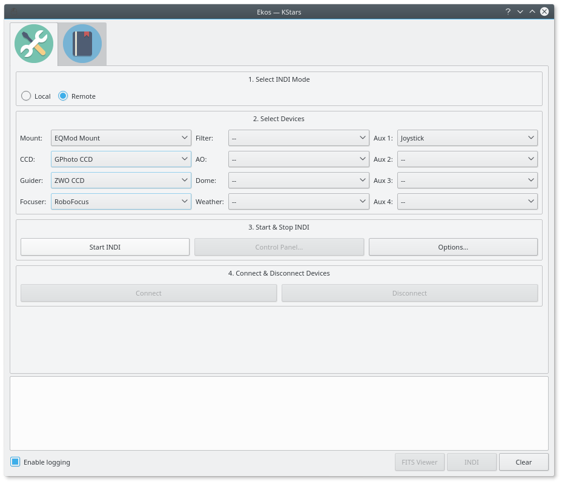
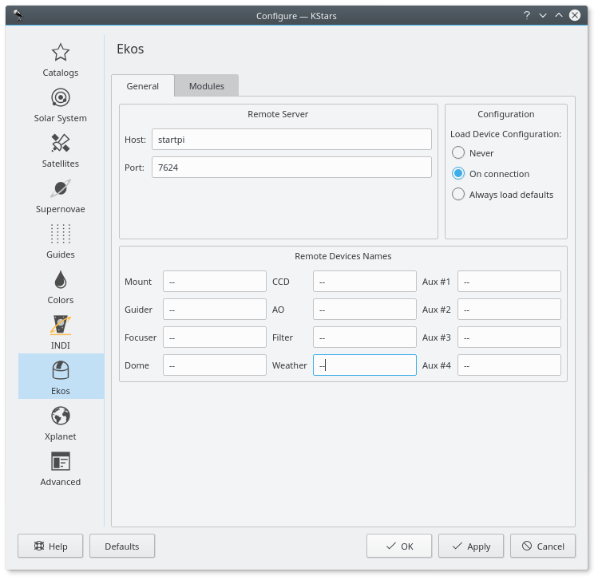

INDI is by design a distributed control protocol where multiple INDI servers may span different hosts and on different network topologies. This enables an N to N communication between front end clients and backend servers. When operating a local or remote observatory, it might be necessary to run INDI servers on multiple devices. If you are using Ekos as your client of choice, then it is necessary that all remote INDI servers are _chained_, that is, they should all be linked together as to appear at **one** INDI server to Ekos.

Thankfully, INDI servers support chaining among themselves. In this tutorial, we shall explore a hypothetical scenario where you have two Raspberry PIs over the local network (WiFi or LAN) and each Pi is connected to several devices.

First and foremost, you have to decide which device should act as the primary INDI server host. If you have two identical devices, then it shouldn't matter which is which, any device can be the primary. As a general rule of the thumb, the more powerful device with faster and reliable connection should act as the primary device. In our example, Raspberry Pi #1 is the primary device. For each device, it is recommended to use an alias for the IP address. Raspberry Pi #1 alias is **starpi** and has an IP address of 192.168.1.50. On the other hand, Raspberry Pi #2 alias is **astropi** with an IP address of 192.168.1.51

We have the following devices connected to each Pi:

1.  **starpi (192.168.1.50)**:
    -   Joystick
    -   EQMod Mount
    -   Canon DSLR
2.  **astropi (192.168.1.51)**:
    -   Robo Focus
    -   ZWO CCD

In order to refer to the devices by their alias, we need to add them to the _/etc/hosts_ file on the PC/Device running Ekos, and also on the Raspberry PIs. So on **each** device, you can run the following commands:

```shell

sudo echo "192.168.1.50   starpi"  >> /etc/hosts
sudo echo "192.168.1.51   astropi" >> /etc/hosts
```

Now when you run `ping starpi`, you should see it is pinging 192.168.1.50

Since **astropi** is the secondary device, we start the INDI server there first because we will connect to it later from the primary device:

```shell

indiserver -m 100 -vv indi_robo_focus indi_asi_ccd
```

It is important to note that in order to chain this INDI server to the primary server that we shall create later on, we need to know the device names. For most devices, the device name is static and does not change. While other devices get their name at run-time according to the actual model detected. For Robo Focus, the device name is always static **RoboFocus**, but for ZWO CCD, the actual device name depends on the model of the camera you have. The device name is also the same name you get in the INDI control panel. If you start indiserver with with **\-vv** option above, it will display more verbose information including the device names. You only need to use the **\-vv** argument if you don't know the exact device name.

```text

2016-02-23T13:07:42: startup: indiserver -m 100 -vv indi_robo_focus indi_asi_ccd
2016-02-23T13:07:42: Driver indi_robo_focus: pid=10202 rfd=3 wfd=6 efd=7
2016-02-23T13:07:42: Driver indi_asi_ccd: pid=10203 rfd=4 wfd=9 efd=10
2016-02-23T13:07:42: listening to port 7624 on fd 5
2016-02-23T13:07:42: Driver indi_asi_ccd: sending
2016-02-23T13:07:42: Driver indi_robo_focus: sending
2016-02-23T13:07:42: Driver indi_robo_focus: read
2016-02-23T13:07:42: Driver indi_robo_focus: read
2016-02-23T13:07:42: Driver indi_robo_focus: read
2016-02-23T13:07:42: Driver indi_robo_focus: read
2016-02-23T13:07:42: Driver indi_robo_focus: read
2016-02-23T13:07:42: Driver indi_robo_focus: read
2016-02-23T13:07:42: Driver indi_robo_focus: read
2016-02-23T13:07:42: Driver indi_asi_ccd: read
2016-02-23T13:07:42: Driver indi_asi_ccd: snooping on Telescope Simulator.EQUATORIAL_EOD_COORD
2016-02-23T13:07:42: Driver indi_asi_ccd: read
2016-02-23T13:07:42: Driver indi_asi_ccd: snooping on Telescope Simulator.TELESCOPE_INFO
2016-02-23T13:07:42: Driver indi_asi_ccd: read
2016-02-23T13:07:42: Driver indi_asi_ccd: snooping on CCD Simulator.FILTER_SLOT
2016-02-23T13:07:42: Driver indi_asi_ccd: read
2016-02-23T13:07:42: Driver indi_asi_ccd: snooping on CCD Simulator.FILTER_NAME
2016-02-23T13:07:42: Driver indi_asi_ccd: read
2016-02-23T13:07:42: Driver indi_asi_ccd: read
2016-02-23T13:07:42: Driver indi_asi_ccd: read
2016-02-23T13:07:42: Driver indi_asi_ccd: read
2016-02-23T13:07:42: Driver indi_asi_ccd: read
```

Here we can see that the actual device name is **ZWO CCD ASI120MC**. Now, we login to **starpi** and start INDI server:

```shell

indiserver -m 100 -v indi_joystick indi_eqmod_telescope indi_gphoto_ccd "RoboFocus"@astropi "ZWO CCD ASI120MC"@astropi
```

This will start INDI server on **starpi** and _chain_ it to the INDI server running over at **astropi**.

In Ekos Setup, select **Remote** mode and then select all your devices as illustrated below.



Next, open Ekos options and change the host to **starpi** and port to **7624**. Now you're good to go! Simple click _Start INDI_ and it will connect to to the remove devices. You should see all the devices popping up in INDI control panel.



Next simply click **Connect** in Ekos Setup and all your device should come online so you can start using Ekos right away!

You can accomplish remote startup and chaining of the INDI devices in a simple Python script. You run the the script on the same machine running Ekos, and it can SSH into the remote devices and start the corresponding INDI servers. For the script to work, you must be able to login to the Raspberry PIs using PKI authentication (SSH Keys) and not password.
