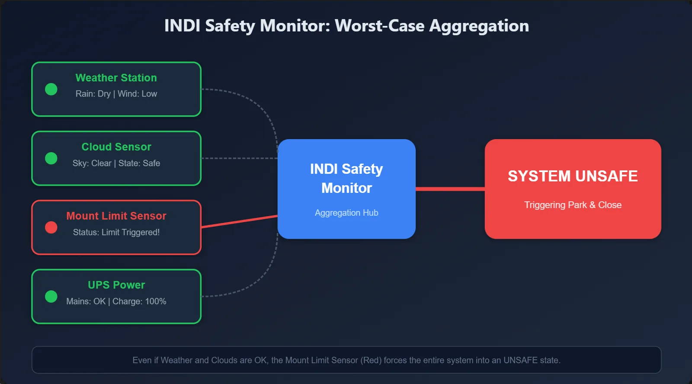
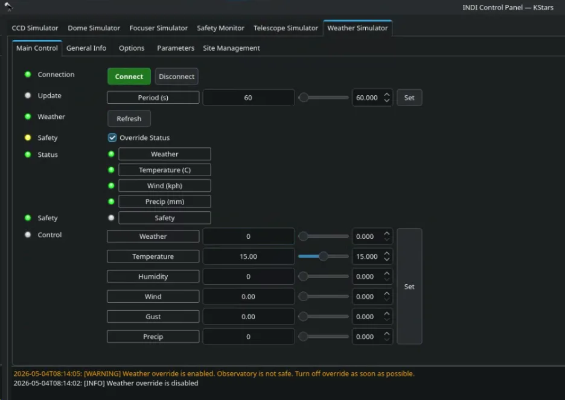
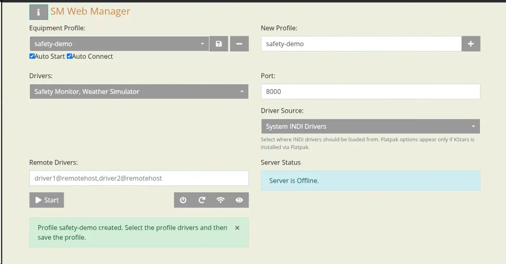
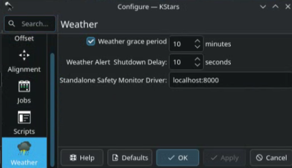
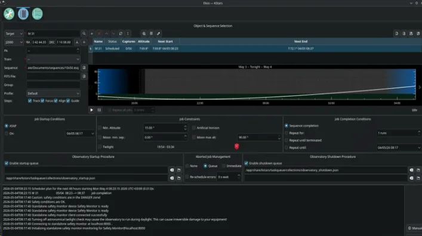

The **INDI Safety Monitor** is a versatile auxiliary driver designed to safeguard your observatory. It acts as a central hub, **aggregating safety data from multiple INDI devices** into one clear, unified status. By monitoring weather stations, power supplies, cloud sensors, and other critical hardware simultaneously, it ensures your equipment stays protected under any conditions.



* * *

## Why Use a Safety Monitor?

Running an automated or remote observatory requires constant vigilance. The Safety Monitor simplifies this by providing a "single source of truth" for your system's health:

-   **Centralized Monitoring**: Keep track of multiple devices from a single interface.
-   **Worst-Case Logic**: If even one monitored device reports an unsafe condition, the entire system is immediately flagged as **Unsafe**. This "fail-safe" approach ensures maximum protection.
-   **Seamless Integration**: It provides a standard interface that Ekos and custom control scripts use to trigger automated shutdowns or pause imaging.

With the safety monitor, it is possible for clients like Ekos Scheduler to execute multi-night scheduling sessions whereas the observatory can shutdown if necessary due to adverse weather conditions and wait until the conditions improve to resume the jobs.

* * *

## How It Works

### Device Aggregation

Safety Monitor tracks the `SAFETY_STATUS` property of every connected device. Each device is represented by a status indicator, with the overall system state reflecting the **worst case** among them:

| Status | Meaning |
| --- | --- |
|  **Idle** (Gray) |  The device hasn't started reporting yet. |
|  **OK** (Green) |  Conditions are safe; proceed with observation. |
|  **Busy** (Yellow) |  Warning; conditions are marginal. Proceed with caution. |
|  **Alert** (Red) |  **Unsafe**; conditions require immediate attention or shutdown. |

### Configuration

Setting up your monitor is straightforward. You define your monitored hardware using a comma-separated list of connection strings.

**Format:** `DeviceName@host:port`

Examples:

-   Local Device: `Open Weather Map` (Connects to localhost:7624 by default)
-   Mixed Setup: `Open Weather Map, UPS@localhost:7624`
-   Remote Hardware: `Weather Station@192.168.1.5, Power Supply@192.168.1.10:7624`

> [!NOTE]
> **Tip**: If you omit the `@host:port`, it defaults to `localhost:7624`. If you omit just the port, it uses the standard INDI port `7624`.
>
> Your configuration is automatically saved and will be restored in your next session.

* * *

## Manual Override

Sometimes you need to bypass automated alerts—for maintenance or testing. The Safety Monitor includes a **manual override switch** to force the status to "Safe."



> [!WARNING]
> **Caution**: Use the override sparingly. When active, the driver will log persistent warnings to remind you to disable it. Never leave your observatory unattended while the override is enabled.

* * *

## Real-World Use Cases

-   **Weather Protection**: Monitor rain, wind, and cloud cover via drivers like _Open Weather Map_, _AAG Cloud Watcher_, or _WeatherFlow_.
-   **Power Security**: Watch your UPS and power controllers. If the grid fails or battery levels drop, the system triggers a safety alert.
-   **Cloud & Sky Quality**: Integrate dedicated cloud sensors or sky quality meters to stop imaging when transparency drops.
-   **Enclosure Safety**: Link your dome or roof drivers to ensure the observatory only operates when the structure is in a safe state.

You can chain all of these together for total peace of mind:

```shell
indiserver -p 8000 indi_safetymonitor indi_simulator_weather "Cloud Watcher"@mysite.com:9000 UPS Dome Safety@192.168.1.10
```

* * *

## Getting Started

The Safety Monitor should run using a dedicated indiserver separate from the one used by your equipment profile. You can start it either directly via the terminal or by creating a profile in INDI Web Manager or via a systemd service. If the safety monitor driver is running on the same machine as the rest of your equipment, select a different INDI port in the INDI Web Manager profile settings (e.g. 8000) then start the profile. You can also enable **Autostart** and **Autoconnect** in that profile to ensure the Safety Monitor starts automatically after boot.

1.  **Launch your hardware drivers**: Ensure your weather stations, UPS, or other safety devices are running.
2.  **Start the Safety Monitor**:

-   -   Using Terminal

```shell
indiserver -p 8000 indi_safetymonitor indi_simulator_weather
```

-   -   Using Webmanager
-   
-   Using Systemd

```shell
sudo nano /etc/systemd/system/indi-safety-monitor.service
```

```ini
[Unit]
Description=INDI Server with Safety Monitor and Weather Drivers
After=network.target

[Service]
Type=simple
# Run as a specific user. Change to your actual username if needed.
User=root
ExecStart=/usr/bin/indiserver -p 8000 indi_safetymonitor indi_simulator_weather
Restart=on-failure
RestartSec=5

[Install]
WantedBy=multi-user.target
```

```shell
# Reload systemd to pick up the new service file
sudo systemctl daemon-reload

# Enable the service to run on startup
sudo systemctl enable indi-safety-monitor.service

# Start the service immediately
sudo systemctl start indi-safety-monitor.service
```

* * *

## Integration with clients

Currently, Ekos Scheduler has full support for the INDI Safety Monitor. To configure Ekos Scheduler:

-   In the **Scheduler** tab, go to **Options** and locate the **Weather** section.
-   Mark the "Weather grace period" as checked. (Wait minutes for the weather to improve before giving up)
-   Enter the address of your Safety Monitor driver and your device connection string.



**Monitor the Status**: the `SAFETY_STATUS` Property will keep an eye on your observatory's health in real-time.



The Safety Monitor will allow you to:

-   **Automate Shutdowns**: Park the mount and close the roof automatically when conditions turn red.
-   **Pause Sequences**: Automatically pause imaging during "Yellow" (marginal) conditions and resume when things clear up.
-   **Dashboard Alerts**: See your observatory's safety status at a glance directly on the Ekos dashboard.
