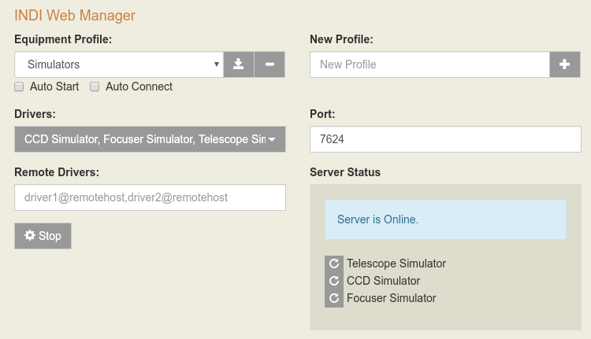

INDI Web Manager is a simple Web Application to manage [INDI server](/develop/developer-manual/92-indi-server.html). It supports multiple driver profiles along with optional custom remote drivers. It can be used to start INDI server locally, and also to connect or _chain_ to remote INDI servers. It is especially useful to install on remote Raspberry PIs installations where you can easily startup INDI server without needing to SSH into the device. Furthermore, the Web Manager provides a [RESTful API](https://en.wikipedia.org/wiki/Representational_state_transfer) where you can issue simple calls to start and stop INDI services over the network.

For more information on how to install indiweb and using the API, check the project's [GitHub page](https://github.com/knro/indiwebmanager).



Under Ubuntu, it's can be installed via the following commands:

```shell
sudo apt-get install python3-pip
sudo -H pip3 install indiweb
```
