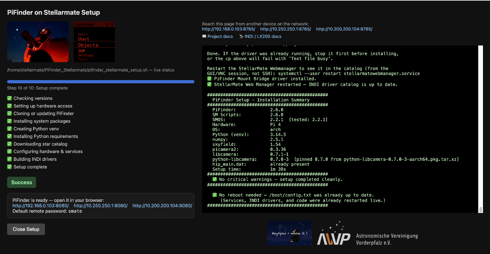
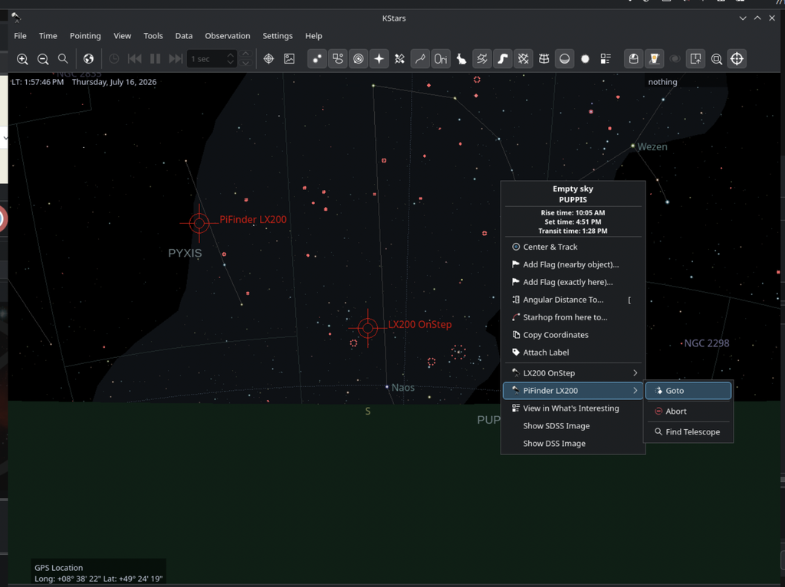
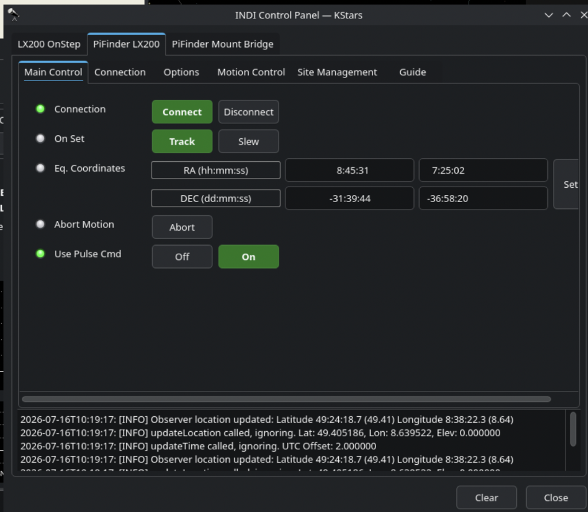
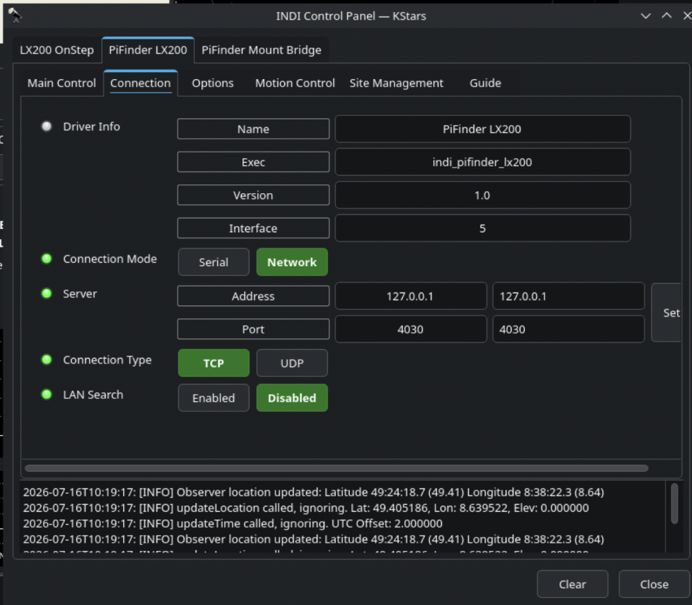
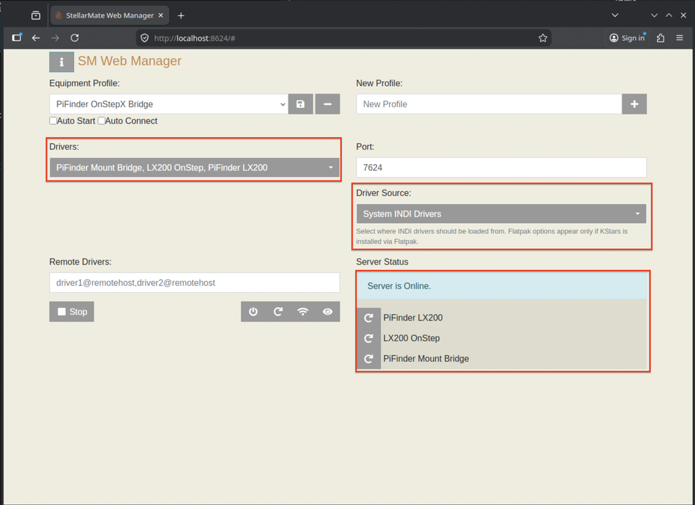
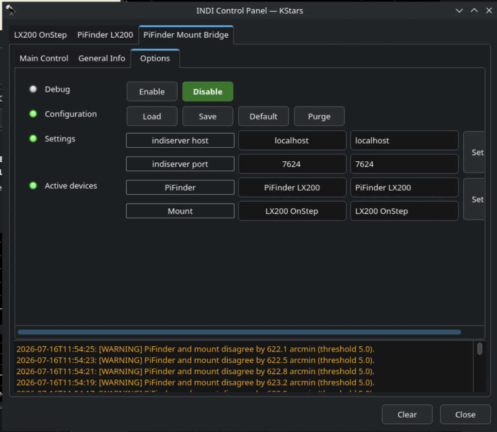
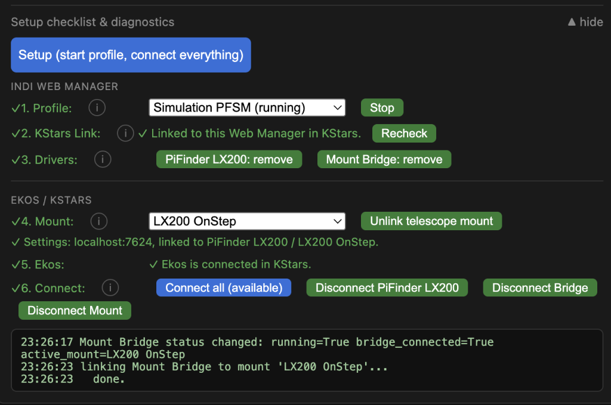

The INDI community is always looking for new ways to connect astronomical hardware and software into flexible, open, and interoperable systems. A new project by INDI community member Axel (HeyApos) brings the open-source **PiFinder** into the StellarMate and INDI ecosystem, turning a Raspberry Pi-based electronic finder into a powerful companion for visual observing, mount control, and astrophotography.

## What is PiFinder?

PiFinder is an open-source, Raspberry Pi-based telescope positioning and finding system. Using a camera, star databases, an IMU, and GPS, it determines where the telescope is pointing by analyzing the night sky.

Unlike a conventional optical finder, PiFinder can continuously determine the telescope's position and provide Push-To guidance to astronomical objects. It can also integrate with applications such as SkySafari and provide a web interface for controlling and monitoring the device.

The project is designed with open-source hardware and software in mind, and can be built using readily available components and 3D-printed parts.

For more information, see the [PiFinder documentation](https://pifinder.readthedocs.io/en/release/index.html).

## PiFinder + StellarMate

The new **PiFinder-Stellarmate** project integrates PiFinder with StellarMate OS and, more importantly, brings INDI into the picture.

The project has been developed with a few fundamental principles:

-   Keep the original PiFinder software as untouched as possible.
-   Decouple the different components so they can be used independently.
-   Work with any INDI-compatible mount rather than tying the project to a particular manufacturer.
-   Reuse the existing capabilities of KStars, Ekos, INDI, and SkySafari.
-   Keep the integration lightweight and focused rather than duplicating functionality already provided by the INDI ecosystem.

The result is a compact INDI driver for PiFinder together with an **INDI PiFinder/Mount Bridge**, allowing the PiFinder and a mount to exchange pointing information and remain synchronized.

## From Push-To Finder to Mount Control

One of the most interesting aspects of the project is that PiFinder does not have to replace the existing INDI workflow. Instead, it can complement it.

For a visual observer, PiFinder can act as an electronic Push-To finder. The observer can select an object and receive guidance for moving the telescope toward it.

With an INDI-compatible mount, the PiFinder can also participate in a more advanced workflow where the mount and finder exchange their pointing information.

This opens up interesting possibilities for telescopes that do not traditionally have a GoTo system. A manually operated telescope can use PiFinder for accurate object finding, while an INDI-compatible mount can provide tracking and/or GoTo functionality when available.

The project has already been tested with different types of mounts and observing configurations, including Dobsonian and Alt/Az setups.

## A Fully Networked INDI Architecture

The project has evolved beyond the original idea of simply running everything on a single Raspberry Pi.

Version 1.3.0 introduced three explicit operating roles through the PiFinder-Stellarmate Control Center:

### All-in-one

PiFinder and the mount are handled by the same StellarMate/Raspberry Pi system.

This is the simplest configuration and is particularly suitable for compact setups.

### PiFinder Host

The Raspberry Pi runs PiFinder as a dedicated finder device, without directly controlling a mount.

This makes it possible to use PiFinder primarily as a Push-To or electronic finder while another computer handles the rest of the astronomy workflow.

### Control Host

A separate computer runs the INDI components and mount control, while the PiFinder operates remotely on another Raspberry Pi.

The two systems communicate over the network.

This last configuration is particularly interesting for observatories and more complex setups. For example, a Raspberry Pi 4 can be mounted directly on the telescope and dedicated to PiFinder, while a more powerful StellarMate or Intel-based computer handles KStars, Ekos, imaging, EAA, and mount control.

The architecture, therefore, does not require PiFinder and the main INDI computer to be the same physical machine.

## INDI Makes the Separation Possible

This is where the project fits naturally into the INDI ecosystem.

Instead of building a custom communication mechanism between PiFinder and every possible mount or astronomy application, the project uses INDI as the common interface.

That means the mount can remain an ordinary INDI device, while PiFinder becomes another component in the INDI environment.

The project also makes use of **INDI Web Manager**, allowing different network configurations to be combined. A PiFinder and StellarMate system can therefore be separated across the network while continuing to work together.

This also means that an Intel-based StellarMate/Ekos computer can work with a separate Raspberry Pi running PiFinder.

## StellarMate Control Center

Recent versions of PiFinder-Stellarmate include a web-based **PiFinder-Stellarmate Control Center**.

The Control Center provides installation and update management, configuration of the PiFinder and INDI components, mount-bridge configuration, and different development/release workflows.

The project also provides use-case-driven configuration for the different mount coupling modes, making it possible to configure the system without manually assembling every part of the INDI setup.

The goal is to keep configuration complexity inside the Control Center and the INDI driver, rather than adding large amounts of PiFinder-specific logic to KStars or Ekos.

## Designed to Stay Decoupled

One particularly interesting design decision is that the integration is intentionally minimal.

Rather than modifying PiFinder heavily or embedding PiFinder-specific functionality into Ekos, the project aims to keep the individual components independent:

**PiFinder → INDI → Mount / KStars / Ekos / other INDI clients**

This makes the architecture easier to maintain and potentially allows the same work to benefit other INDI-based environments.

Future work includes further decoupling from StellarMate OS and supporting other distributions and configurations, including Arch Linux, Ubuntu, Debian, NixOS, Astroberry, stock KStars/Ekos, and INDI Web Manager.

The project also aims to contribute tested improvements back to the PiFinder project, including the INDI stack developed as part of this integration.

## Raspberry Pi 4 and Raspberry Pi 5

The project initially focused on the Raspberry Pi 4 and StellarMate OS 2.x.

Pi 5 support was subsequently confirmed as well. An apparent Pi 5 problem turned out to be related to a hardware defect in the PiFinder hat rather than a fundamental software incompatibility.

The project therefore supports both Pi 4 and Pi 5 hardware, with continued testing and development underway.

## An Interesting New Option for INDI Users

PiFinder is an excellent example of what makes the INDI ecosystem interesting: hardware does not have to belong to a single, closed ecosystem.

A small Raspberry Pi with a camera and PiFinder can provide accurate telescope positioning, while INDI provides the communication layer that connects it to mounts, KStars, Ekos, and other astronomy software.

For a visual observer, it can provide an advanced electronic Push-To system.

For an existing GoTo mount, it can provide an additional source of pointing information.

For an observatory, it can even become a dedicated networked finder running independently from the main control computer.

And because both PiFinder and the integration are open source, users and developers can inspect, modify, and extend the system.

## Getting Started

The **PiFinder-Stellarmate** project, installation instructions, design decisions, and INDI integration documentation are available on GitHub:

[PiFinder-Stellarmate on GitHub](https://github.com/apos/PiFinder_Stellarmate)

The project documentation includes:

-   Quick Start and installation instructions
-   PiFinder/LX200 integration
-   INDI PiFinder driver information
-   Mount Bridge documentation
-   Architecture and design decisions
-   Control Center configuration
-   Development and testing workflows

For those new to PiFinder, the official [PiFinder documentation](https://pifinder.readthedocs.io/en/release/index.html) provides an overview of the hardware, software, operation, and DIY build.

The project is an exciting addition to the INDI ecosystem and demonstrates how a small, open-source Raspberry Pi device can be combined with INDI to bridge the gap between visual observing, electronic finding, mount control, and full KStars/Ekos workflows.

A big thank you to Axel (HeyApos) for developing and testing the integration and for bringing the project to the INDI community.
