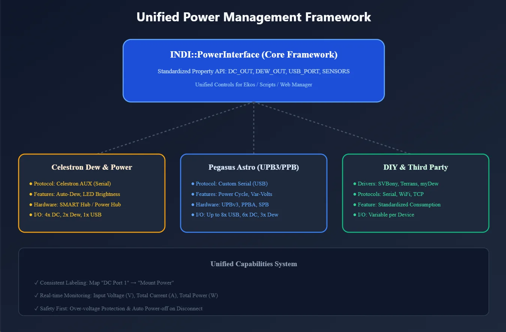
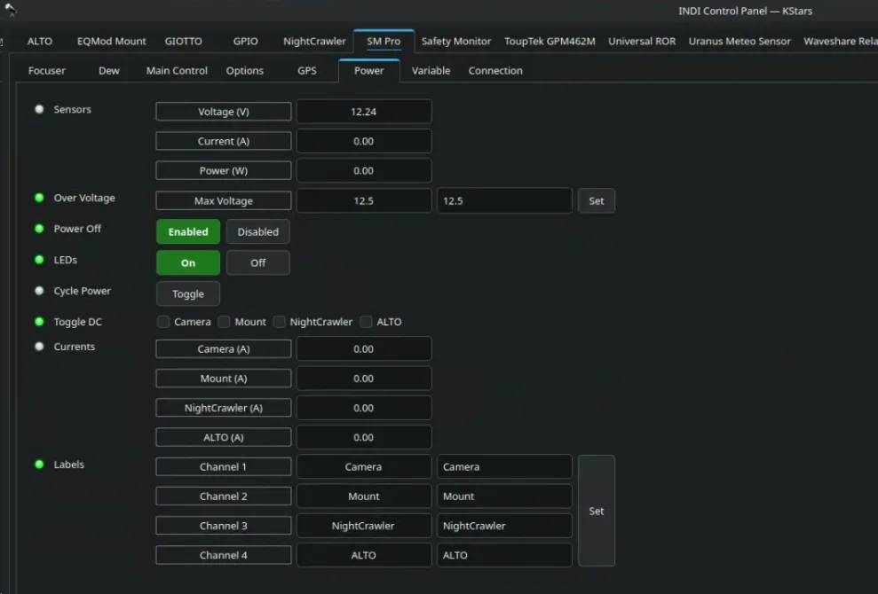
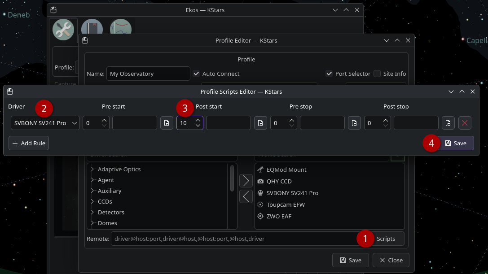

Managing power distribution is the backbone of any reliable observatory. To make this easier, INDI uses a standardized **Power Interface framework**. This ensures that whether you're using a high-end Pegasus hub or a DIY controller, you get a consistent, easy-to-use experience for keeping your gear running smoothly.

* * *

## The Power Interface Framework

In the past, every power controller had its own way of doing things. The new [INDI Power Interface](https://docs.indilib.org/interfaces/power-interface.html) changes that by providing a unified API. This means all supported devices share a consistent set of controls and monitoring tools, making it much simpler to switch or upgrade hardware.

### What Your Controller Can Do

Depending on your hardware, the interface gives you access to a wide range of smart features:

| Feature | What it does |
| --- | --- |
| **DC Power Ports** | Individual on/off switches for your 12V equipment. |
| --- | --- |
| **Dew Heater Ports** | Precise control (0–100%) to keep your optics clear. |
| --- | --- |
| **Variable Voltage** | 3-12v adjustable voltage required for some devices (e.g. DSLRs)
 |
| --- | --- |
| **Voltage Monitoring** | Usually covers input voltage and output variable voltage. If the voltage drops too low or jumps too high, the firmware should protect the connected equipment. |
| --- | --- |
| **Current Tracking** | Monitor total or per-port current draw to avoid overloads. |
| --- | --- |
| **USB Control** | Remotely toggle USB power ports. |
| --- | --- |
| **Auto-Dew Mode** | Automatically adjust heaters based on temperature and humidity. |
| --- | --- |
| **Safety Features** | Protection against over-voltage and automatic power-downs on disconnect. |
| --- | --- |

### Custom Port Labels

No more guessing which cable goes where. You can assign **custom labels** to every port (e.g., "Mount," "Main Camera," "Filter Wheel"). These labels stay with your device, so you'll always know exactly what you're toggling.

* * *

## Power Controller Comparison

Choosing the right hub depends on your setup's complexity. Here is how the most popular controllers stack up:

| Controller | DC Power Ports | Dew Heater Ports | Variable Voltage | USB Control | Voltage Monitoring | Current Tracking | Auto-Dew Mode |
| --- | --- | --- | --- | --- | --- | --- | --- |
|  **[StellarMate PRO](https://stellarmate.com/products/stellarmate-pro-128gb/stellarmate-controllers/stellarmate-pro-128gb-detail.html)** | 4 | 2 | 1 | 6 | ✓ | ✓ | ✓ |
| --- | --- | --- | --- | --- | --- | --- | --- |
|  **Celestron Smart Dew** | ✓ | ✓ | ✓ | ✓ | ✓ | ✓ | ✓ |
| --- | --- | --- | --- | --- | --- | --- | --- |
|  **[Pegasus UPB3](https://drivers.indilib.org/observatory-controllers/pegasus-astro/pegasus-upbv3/pegasus-upbv3/)** | 6 | 3 | 2 | 8 | ✓ | ✓ | ✓ |
| --- | --- | --- | --- | --- | --- | --- | --- |
|  **[Pegasus UPB](https://drivers.indilib.org/observatory-controllers/pegasus-astro/pegasus-ultimate-power-box/pegasus-ultimate-power-box/)** | 4 | 3 | 1 | 6 | ✓ | ✓ | ✓ |
| --- | --- | --- | --- | --- | --- | --- | --- |
|  **[Pegasus PPBA](https://drivers.indilib.org/auxiliaries/pegasus-astro/pegasus-ppb/pegasus-ppb/)** | 1 | 2 | ✓ | — | ✓ | ✓ | ✓ |
| --- | --- | --- | --- | --- | --- | --- | --- |
|  **[SVBony Powerbox](https://drivers.indilib.org/auxiliaries/svbony/svbony-powerbox/svbony-powerbox/#_top)** | 5 | 2 | 1 | 2 | ✓ | — | — |
| --- | --- | --- | --- | --- | --- | --- | --- |
|  **[Terrans Pro V2](https://drivers.indilib.org/observatory-controllers/terrans-industry/terrans-powerboxpro-v2/terrans-powerboxpro-v2/)** | 7 | — | 1 | 6 | ✓ | ✓ | — |
| --- | --- | --- | --- | --- | --- | --- | --- |
|  [**CheopoDC**](https://drivers.indilib.org/observatory-controllers/generic/cheapodc/cheapodc/) | ✓ | ✓ | — | — | — | — | ✓ |
| --- | --- | --- | --- | --- | --- | --- | --- |
|  **[myDewController](https://drivers.indilib.org/auxiliaries/generic/mydewcontrollerpro/mydewcontrollerpro/)** | — | 3 | — | — | — | — | ✓ |
| --- | --- | --- | --- | --- | --- | --- | --- |

> [!NOTE]
> **Note**: "✓" indicates supported or auto-detected features. Port counts are fixed by the hardware.

* * *

## Featured Hardware

### Celestron Smart Dew & Power Controller (NEW)

This brand-new driver brings full support for Celestron’s latest power hubs. It communicates using the robust Celestron AUX protocol.

-   **Smart Management**: Toggle DC and USB ports individually.
-   **Precision Heating**: Manual or fully automatic dew control.
-   **Safety First**: Includes built-in alerts for over-current and voltage fluctuations.
-   **High Performance**: Uses hardware-level handshaking (RTS/CTS) for rock-solid reliability.

### Pegasus Astro Power Controllers

Pegasus hubs are the industry standard for observatory power.

-   **Ultimate Powerbox (UPB/UPB3)**: The "everything" hub. Massive port counts, USB switching, and full environmental sensing.
-   **Pocket Powerbox (PPB/PPBA)**: Compact and perfect for mobile setups or small scopes.
-   **Smart Powerbox (SPB)**: Intelligent power delivery in a mid-sized package.

* * *

## Automated Power Sequencing

For permanent observatories where your power controller stays powered 24/7, you can automate the startup and shutdown. This ensures that your mount, cameras, and accessories draw power only when you're actually imaging.

### How it Works

Most modern controllers (including StellarMate Pro and Pegasus) support the **Power Off on Disconnect** feature (found in the driver's _Power_ tab).

-   **When Enabled**: The controller automatically cuts power to all ports whenever the INDI driver disconnects. This typically happens when you stop your Ekos equipment profile.
-   **When Disabled**: Ports maintain their state even after disconnection.

### Setting Up a Power-Sequenced Startup

If your power controller DC output is off by default and only toggled on after the driver is started, then an issue arises if all drivers are started at the same time since the Mount, Camera..etc drivers are not powered yet and therefore Ekos will not be able to detect them. To fix this issue, Ekos provides Scripts feature in the equipment profile where you can control the pre and post-behavior for drivers. Typically, you need to select the power driver then add a 5 to 10 seconds Post-Startup delay. This way, the power controller driver starts then it powers on the rest of the devices, which allows them to be recognized after the delay period is completed.

**Open Ekos** and go to your **Equipment Profile** dialog:

1.  **Open Scripts**: Click the **Scripts** button to launch the **Profile Scripts Editor**.
2.  **Add a Rule**: Click **Add Rule** to create a new automation for your power controller.
3.  **Configure the Stages**:
    -   **Driver**: Select your power controller.
    -   **Post-start**: Enter a **delay** (e.g., 5 to 10 seconds). This is crucial because hardware like mounts and cameras takes time to physically power on and initialize. The delay ensures your equipment is fully ready _before_ Ekos attempts to start the imaging session.
    -   **Pre-stop**: Useful for shutting down specific accessories before the main driver disconnects.
4.  **Save**: Click **Save** to apply the rules to your profile.

Once configured, starting your Ekos profile will automatically trigger your "Post-start" sequence, powering on your mount and cameras without any manual intervention.

> [!WARNING]
> **Note**: "Power Off Disconnect" only works if it is handled by the driver.
>
> i.e. if you power off manually, then it would not restore power next time ekos profile is started.
