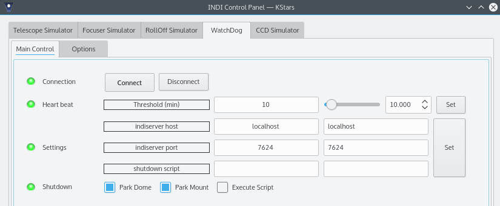

When operating a remote observatory, complete control of the devices rest with the remote INDI servers and drivers. In case of a communication loss, the observatory should be capable of performing a _graceful_ shutdown until communication is established again by the client.

Since the actual shutdown procedure can be unique to each observatory, the user should be able to configure the exact required shutdown procedure. But for most users, the usual shutdown procedure involves parking the mount followed by parking the dome, if one exists. Using INDI **WatchDog** driver, the user can secure their remote observatory by setting a _heart beat_ timeout threshold. A heart beat is a signal from the client to the watchdog driver to inform it that communication is OK. The user can configure the heart beat timeout in _minutes_ in the WatchDog driver. If the driver does not receive the signal after the heart beat timeout threshold, it initiates the shutdown procedure. To disable the heart beat check, set it to zero.

The shutdown procedure is currently composed of the following steps in order:

1.  **Park Mount**: The mount driver specified under _Options_ tab will be commanded to park. After parking is successful, the driver proceeds to the next step, otherwise it aborts the shutdown procedure.
2.  **Park Dome**: The dome driver specified under _Options_ tab will be commanded to park.
3.  **Execute Script**: Execute a custom shutdown script as specified in the settings property. The script must be executable and exits successfully for this operation to be considered successful.

To park the mount and dome, the driver needs to act as a client as well in order to issue such commands. You need to specify the indiserver host and port where the dome and mount drivers are running. This is usually _localhost_ at port _7624_ which is the default value. The shutdown script can be used to perform any additional shutdown functions (e.g. turn off power, send email...etc). You can use [Python INDI Client](https://sourceforge.net/projects/pyindi-client/) library to command devices, or INDI's built in [scripting tools](/develop/developer-manual/104-scripting.html). All values can be saved in the config file by going to **Options** and clicking **Save** under the _Configuration_ property. On subsequent runs, all values shall be loaded automatically on start up.

 **Tip:** When starting INDI server on a remote PC/Raspberry PI via SSH, make sure to run indiserver in the background so that if you get disconnected, the indiserver is not terminated. This is accomplished by using nohup command. For example: nohup indiserver -v indi_watchdog indi_simulator_ccd indi_simulator_dome indi_simulator_telescope > /dev/null 2>&1 &
