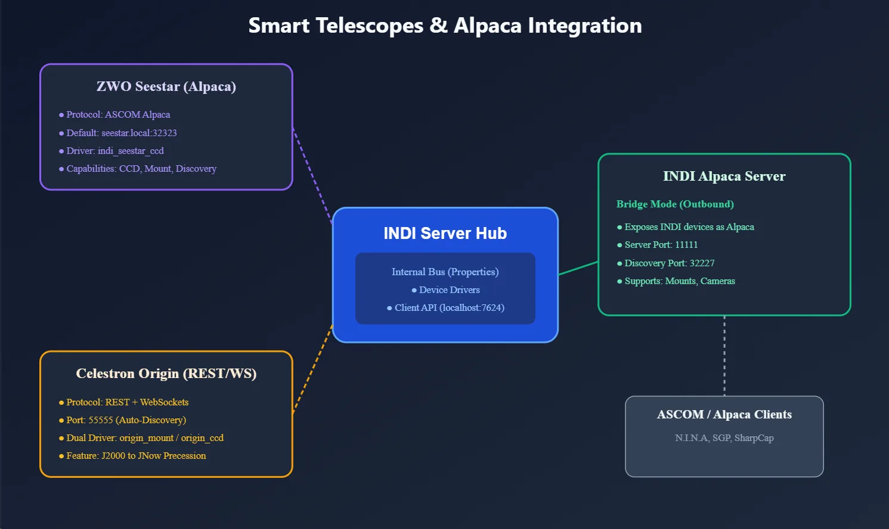
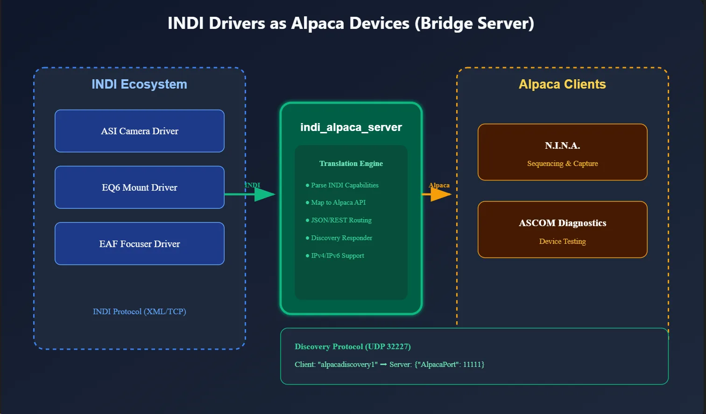
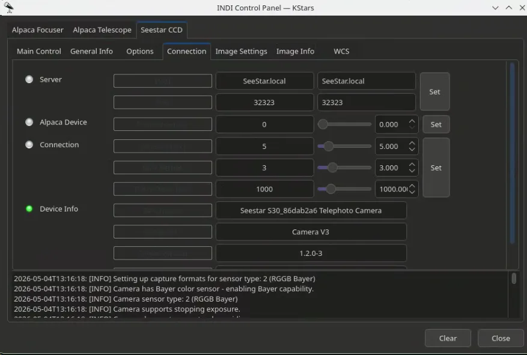
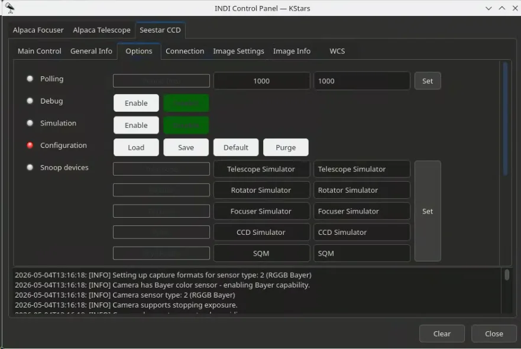
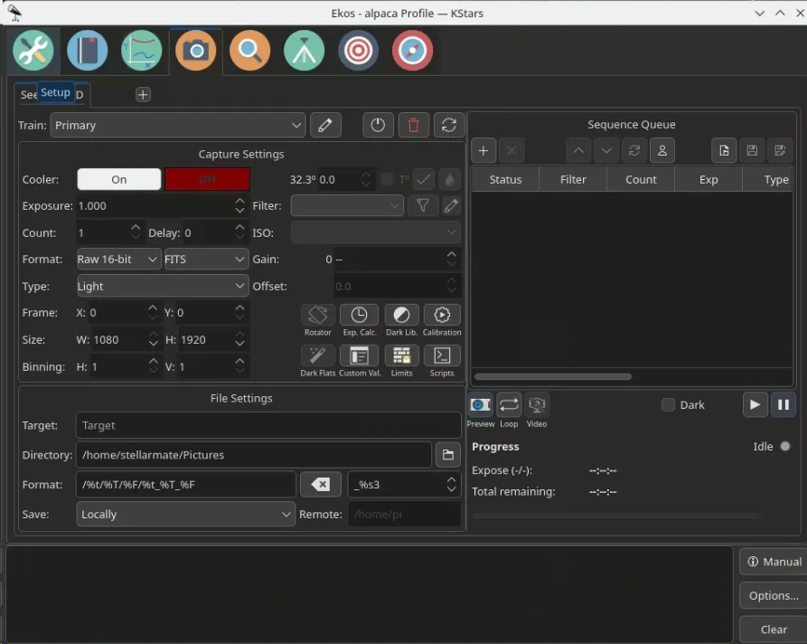

INDI has expanded its support for the growing ecosystem of smart telescopes and Alpaca-native hardware. This is handled through two different approaches: dedicated drivers for devices like the Celestron Origin, and a flexible Alpaca bridge system for devices like the ZWO Seestar.

There are two sides to Alpaca support in INDI:

1.  **Alpaca devices as INDI drivers (INDI to Alpaca)**: Allows you to control Alpaca-only devices from Ekos or any INDI client.

2. **INDI drivers as Alpaca devices (Alpaca to INDI)**: Exposes your existing INDI hardware to ASCOM Alpaca clients on Windows or other platforms.

* * *

## Alpaca Devices as INDI Drivers

Some modern hardware, like the ZWO Seestar, only supports the Alpaca protocol out of the box. To make these work seamlessly in the INDI ecosystem, we've introduced **Alpaca Bridge Drivers**. These drivers act as a bridge, translating Alpaca commands and responses to the INDI protocol.

### How it Works

Think of these as a translator. From the perspective of INDI clients like Ekos or KStars, you are just using a standard INDI driver. Internally, the driver translates all INDI properties and commands into Alpaca REST API calls and sends them to the device over your network.

For each of these drivers, you simply specify the remote Alpaca device's **host**, **port**, and **device number** to establish a connection.

### Available Bridge Drivers

-   **Camera**: `indi_alpaca_ccd`
-   **Mount**: `indi_alpaca_mount`
-   **Focuser**: `indi_alpaca_focuser`
-   **Dome**: `indi_alpaca_dome`
-   **Filter Wheel**: `indi_alpaca_wheel`
-   **Safety Monitor**: `indi_weather_safety_alpaca`

* * *

## ZWO Seestar

The Seestar driver (`indi_seestar_ccd`) is a specialized version of the `indi_alpaca_ccd` bridge. It’s specifically tuned to handle the Seestar’s unique requirements while presenting a standard camera interface to your software.

### Key Details

-   **Zero Config**: It defaults to `SeeStar.local:32323`, so it usually connects automatically.

> [!NOTE]
> **Note**: If the connection fails, please enter the Seestar IP address directly in the Host field.

-   **Natural Integration**: It looks and acts like any other INDI camera.

-   **Smart Handling**: It handles the Seestar's specific image metadata and communication quirks internally.

> [!NOTE]
> **Note**: _Since the Seestar doesn't have an active cooler, temperature controls are disabled in the driver_.

* * *

## Celestron Origin

Unlike the Seestar, the Celestron Origin is supported via a specialized dual-driver that handles both the mount and the camera system.

### Mount Features

-   **Auto-Discovery**: Automatically finds the Origin on port 55555.
-   **Coordinate Sync**: Handles the J2000 to JNow conversion automatically.
-   **Standard Controls**: Supports Slewing, Tracking, Parking, and Syncing.

### Camera Features

-   **High Res & Preview**: Supports both fast JPG previews and full 16-bit TIFF captures.
-   **Automatic Conversion**: The driver converts the Origin's native TIFFs into standard FITS files on the fly, including GAIN metadata.

* * *

## INDI Drivers as Alpaca Devices (INDI Alpaca Server)

If you have INDI hardware (like an ASI camera or an EQ6 mount) and want to use it with Windows software like N.I.N.A or Sequence Generator Pro, the `indi_alpaca_server` is the tool for the job.

### Key Features

-   **Universal Bridge**: It turns your INDI server into an ASCOM Alpaca endpoint.
-   **Network Discovery**: Implements the ASCOM Alpaca Discovery protocol (port 32227). Windows clients can find your INDI setup automatically on the network.
-   **Auto-Mapping**: The server connects to your INDI drivers and automatically generates the appropriate Alpaca device interfaces.

### Configuration

When running the `indi_alpaca_server`, you can configure the following in the INDI control panel:

-   **Alpaca Server Host/Port**: Where the server listens for Alpaca clients (default `0.0.0.0:11111`).
-   **INDI Server Host/Port**: The address of the INDI server to bridge (default `localhost:7624`).
-   **Discovery Port**: The UDP port used for Alpaca discovery (default `32227`).
-   **Connection Settings**: Configure timeout, maximum retries, and retry delay.
-   **Startup Delay**: A delay before connecting to the INDI server to ensure it is fully ready.

### Supported Device Types for Exposure

Currently, the following INDI device types can be exposed as Alpaca devices:

-   Mount
-   Camera

* * *

## Summary

Whether you are trying to use a new smart telescope in Ekos, or trying to use your Linux-based observatory from a Windows laptop, the Alpaca integration in INDI makes the hardware boundaries disappear.
